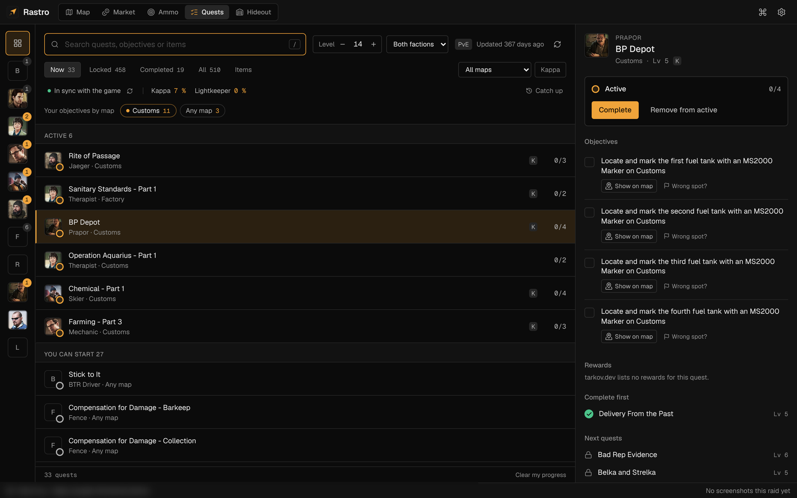
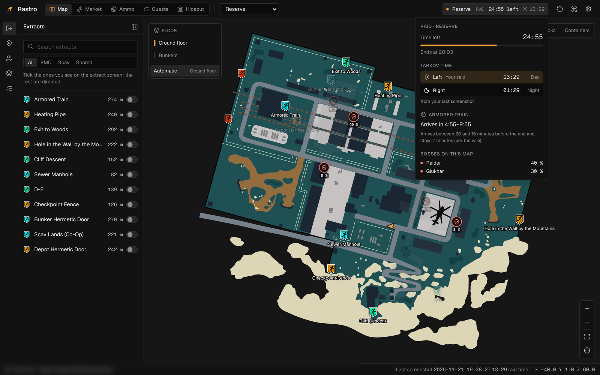

  

  🌐 <a href="README.md">English</a> · <a href="README.es.md">Español</a> · <a href="README.ru.md">Русский</a> · <b>Deutsch</b> · <a href="README.pt-BR.md">Português</a> · <a href="README.fr.md">Français</a> · <a href="README.pl.md">Polski</a> · <a href="README.zh-CN.md">中文</a>
   
  Übersetzung der Community. Wenn etwas vom <a href="README.md">englischen README</a> abweicht, ist die englische Version aktuell. Fehler gefunden? <a href="https://discord.gg/H4pRxGBGDb">Sag uns auf Discord Bescheid</a>.

  
  
  
  
  
  

<h3 align="center">
  <a href="https://github.com/MaxSala/rastro-tarkov/releases/latest/download/Rastro-windows-x64.exe">⬇ Rastro für Windows herunterladen</a>
</h3>

Kostenlos und Open Source · Kein Installer · Kein Konto · Nichts einzurichten

---

**Rastro ist eine Live-Karte deines Raids für den zweiten Monitor.** Mach im Spiel einen Screenshot und deine Position erscheint, mit dem Weg zu jedem Ausgang. Deine Quests, dein Versteck, die Bosse und dein Squad, auf demselben Bildschirm, ohne Alt-Tab.

Es fasst das Spiel nie an: Es liest nur Dateien, die Tarkov ohnehin auf deine Festplatte schreibt. Kostenlos, Open Source, von Spielern für Spieler.

  
   Customs im Raid: deine Position, ein Raid-Plan mit Route, die Bosse und die verbleibende Zeit.

<table>
  <tr><td width="50%" valign="top"> <b>Im Squad spielen</b> Alle auf derselben Karte, verschlüsselt von PC zu PC. Kein Server, kein Konto.</td><td width="50%" valign="top"> <b>Quests, die dem Spiel folgen</b> Aus den Spiel-Logs abgehakt, mit jedem offenen Ziel auf der Karte.</td></tr>
  <tr><td width="50%" valign="top"> <b>Versteck</b> Was die nächste Stufe jedes Moduls braucht und was du nicht verkaufen solltest.</td><td width="50%" valign="top"> <b>Bosse auf der Karte</b> Wo jeder Boss spawnen kann und wie wahrscheinlich, in PvP und PvE.</td></tr>
  <tr><td width="50%" valign="top"> <b>Raid-Uhr</b> Verbleibende Zeit, Tarkov-Zeit auf beiden Seiten und das Panzerzug-Fenster.</td><td width="50%" valign="top"> <b>Preise und Munition</b> Flohmarkt- und Händlerpreise, Schlüssel und jede Patrone, offline durchsuchbar.</td></tr>
</table>

## Ist es sicher?

- Liest nur Dateien, die das Spiel auf die Festplatte schreibt: die **Namen** deiner Screenshots und, wenn du es einschaltest, die Log-Dateien.
- Liest nie den Spielspeicher, sendet keine Eingaben und zeichnet nichts über das Spiel.
- Lauscht nur auf deinem eigenen PC (`127.0.0.1`). Keine Telemetrie, kein Konto.
- Open Source (MIT). Jede Version wird von GitHub Actions aus diesem Code gebaut.

Die ganze Antwort, die Windows-SmartScreen-Warnung und wie du die Datei prüfst: [Fragen und Sicherheit](docs/de/FAQ.md).

## Loslegen

1. **Lade** [`Rastro-windows-x64.exe`](https://github.com/MaxSala/rastro-tarkov/releases/latest/download/Rastro-windows-x64.exe) herunter und starte es. Es gibt nichts zu installieren.
2. **Folge der kurzen Einrichtung.** Sie findet deinen Screenshot-Ordner und lädt die Karten von tarkov.dev.
3. **Mach im Spiel einen Screenshot.** Dein Pfeil erscheint auf der Karte.

## Mehr erfahren

**[Funktionen](docs/de/FEATURES.md)** · **[Anleitung: Installation, Kürzel und Daten](docs/de/GUIDE.md)** · **[Fragen und Sicherheit](docs/de/FAQ.md)** · **[Roadmap](docs/ROADMAP.md)** · **[Neuigkeiten](CHANGELOG.md)** · **[Mitmachen](CONTRIBUTING.md)**

> [!TIP]
> Rastro ist in der öffentlichen Beta, und die Community entscheidet, was als Nächstes kommt. **[⭐ Gib dem Repo einen Stern](https://github.com/MaxSala/rastro-tarkov/stargazers)** und **[komm auf den Discord](https://discord.gg/H4pRxGBGDb)**: Das dauert fünf Sekunden und hilft sehr.

---

Kartenmaterial von den <a href="https://github.com/the-hideout/tarkov-dev-svg-maps">tarkov.dev-Mitwirkenden</a>, CC BY-NC-SA 4.0. Preise und Gegenstandsdaten von <a href="https://tarkov.dev">tarkov.dev</a>. Die Squad-Screenshots verwenden Beispielpositionen. Die Screenshots zeigen die App auf Englisch.
 *Escape from Tarkov* ist eine Marke von Battlestate Games. Rastro steht in keiner Verbindung zu Battlestate Games oder tarkov.dev und wird von ihnen nicht unterstützt.
 MIT-Lizenz · [Credits und Lizenzen Dritter](NOTICE.md)
