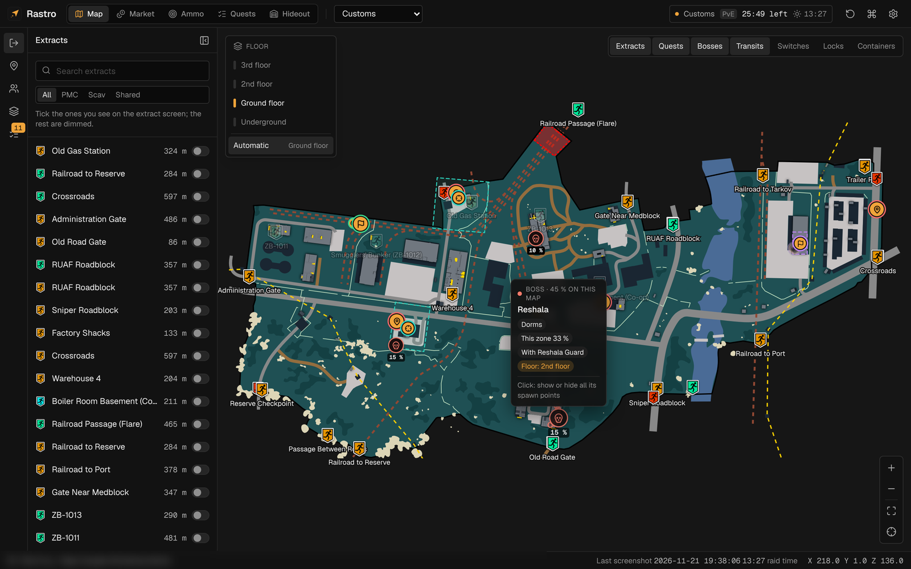

  

  🌐 <a href="README.md">English</a> · <b>Español</b> · <a href="README.ru.md">Русский</a> · <a href="README.de.md">Deutsch</a> · <a href="README.pt-BR.md">Português</a> · <a href="README.fr.md">Français</a> · <a href="README.pl.md">Polski</a> · <a href="README.zh-CN.md">中文</a>
   
  Traducción de la comunidad. Si algo no coincide con el <a href="README.md">README en inglés</a>, el inglés es el que está al día. ¿Has visto un error? <a href="https://discord.gg/H4pRxGBGDb">Avísanos en Discord</a>.

  
  
  
  
  
  

<h3 align="center">
  <a href="https://github.com/MaxSala/rastro-tarkov/releases/latest/download/Rastro-windows-x64.exe">⬇ Descargar Rastro para Windows</a>
</h3>

Gratis y de código abierto · Sin instalador · Sin cuenta · Nada que configurar

---

**Rastro es un mapa en directo de tu raid para tu segundo monitor.** Haz una captura en el juego y aparece tu posición, con el camino a cada extracción. Tus misiones, tu escondite, los jefes y tu squad, en la misma pantalla, sin hacer alt-tab.

Nunca toca el juego: solo lee archivos que Tarkov ya escribe en tu disco. Gratis, de código abierto, hecho por jugadores para jugadores.

  
   Customs en raid: tu posición, un plan de raid con su ruta, los jefes y el tiempo restante.

<table>
  <tr><td width="50%" valign="top"> <b>Juega en squad</b> Todos en el mismo mapa, cifrado de PC a PC. Sin servidor ni cuentas.</td><td width="50%" valign="top"> <b>Misiones que siguen al juego</b> Se marcan solas desde los logs, con cada objetivo pendiente en el mapa.</td></tr>
  <tr><td width="50%" valign="top"> <b>Escondite</b> Qué pide el siguiente nivel de cada módulo y qué no debes vender.</td><td width="50%" valign="top"> <b>Jefes en el mapa</b> Dónde puede aparecer cada jefe y con qué probabilidad, en PvP y PvE.</td></tr>
  <tr><td width="50%" valign="top"> <b>Reloj de raid</b> Tiempo restante, hora en Tarkov a cada lado y la ventana del tren blindado.</td><td width="50%" valign="top"> <b>Precios y munición</b> Precios del mercadillo y de comerciantes, llaves y cada bala, sin conexión.</td></tr>
</table>

## ¿Es seguro?

- Solo lee archivos que el juego escribe en disco: los **nombres** de tus capturas y, si lo activas, los logs.
- Nunca lee la memoria del juego, ni pulsa teclas, ni dibuja encima del juego.
- Solo escucha en tu propio PC (`127.0.0.1`). Sin telemetría ni cuentas.
- Código abierto (MIT). Cada versión la compila GitHub Actions a partir de este código.

La respuesta completa, el aviso de Windows SmartScreen y cómo comprobar el archivo: [Preguntas y seguridad](docs/es/FAQ.md).

## Empieza

1. **Descarga** [`Rastro-windows-x64.exe`](https://github.com/MaxSala/rastro-tarkov/releases/latest/download/Rastro-windows-x64.exe) y ábrelo. No hay nada que instalar.
2. **Sigue la guía breve.** Encuentra tu carpeta de capturas y descarga los mapas de tarkov.dev.
3. **Haz una captura en el juego.** Tu flecha aparece en el mapa.

## Más información

**[Funciones](docs/es/FEATURES.md)** · **[Guía: instalación, atajos y datos](docs/es/GUIDE.md)** · **[Preguntas y seguridad](docs/es/FAQ.md)** · **[Hoja de ruta](docs/ROADMAP.md)** · **[Novedades](CHANGELOG.md)** · **[Contribuir](CONTRIBUTING.md)**

> [!TIP]
> Rastro está en beta pública y la comunidad decide qué viene después. **[⭐ Dale una estrella](https://github.com/MaxSala/rastro-tarkov/stargazers)** y **[únete al Discord](https://discord.gg/H4pRxGBGDb)**: son cinco segundos y ayuda mucho.

---

Mapas de los <a href="https://github.com/the-hideout/tarkov-dev-svg-maps">colaboradores de tarkov.dev</a>, CC BY-NC-SA 4.0. Precios y datos de objetos de <a href="https://tarkov.dev">tarkov.dev</a>. Las capturas de la squad usan posiciones de ejemplo. Las capturas muestran la app en inglés.
 *Escape from Tarkov* es una marca de Battlestate Games. Rastro no está afiliado ni respaldado por Battlestate Games ni por tarkov.dev.
 Licencia MIT · [Créditos y licencias de terceros](NOTICE.md)
