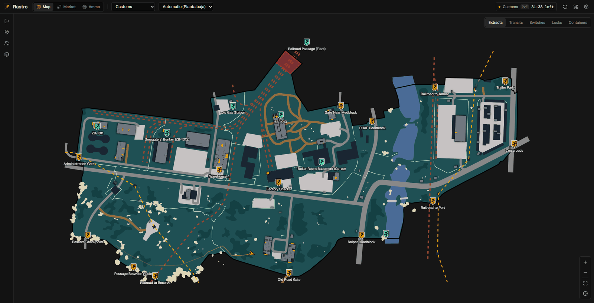

<p align="center">
  
</p>

<p align="center">
  🌐 <a href="README.md">English</a> · <a href="README.es.md">Español</a> · <a href="README.ru.md">Русский</a> · <a href="README.de.md">Deutsch</a> · <a href="README.pt-BR.md">Português</a> · <b>Français</b> · <a href="README.pl.md">Polski</a> · <a href="README.zh-CN.md">中文</a>
  <br>
  <sub>Traduction de la communauté. En cas de différence avec le <a href="README.md">README en anglais</a>, c'est la version anglaise qui fait foi. Une erreur ? <a href="https://discord.gg/H4pRxGBGDb">Dites-le-nous sur Discord</a>.</sub>
</p>

<p align="center">
  <a href="https://github.com/MaxSala/rastro-tarkov/releases/latest"></a>
  
  <a href="https://github.com/MaxSala/rastro-tarkov/stargazers"></a>
  <a href="https://discord.gg/H4pRxGBGDb"></a>
  
  <a href="LICENSE"></a>
</p>

<h3 align="center">
  <a href="https://github.com/MaxSala/rastro-tarkov/releases/latest/download/Rastro-windows-x64.exe">⬇ Télécharger Rastro pour Windows</a>
</h3>

<p align="center">
  Gratuit et open source · Sans installation · Sans compte · Rien à configurer
  <br>
  <a href="#comment-ça-marche">Comment ça marche</a> ·
  <a href="#jouez-avec-votre-squad">Mode squad</a> ·
  <a href="#est-ce-sûr-">Est-ce sûr ?</a> ·
  <a href="#installation">Installation</a> ·
  <a href="#où-va-rastro">Feuille de route</a> ·
  <a href="#participer">Participer</a> ·
  <a href="https://discord.gg/H4pRxGBGDb">Discord</a>
</p>

> [!TIP]
> **Rastro est en bêta publique, et ce n'est que le début.** Les quêtes viennent d'arriver ; la planque, les quêtes en squad et bien plus encore arrivent, et c'est la communauté qui décide de ce qui passe en premier.
> Si la direction vous plaît, **[⭐ mettez une étoile au dépôt](https://github.com/MaxSala/rastro-tarkov/stargazers)** et **[rejoignez le Discord](https://discord.gg/H4pRxGBGDb)**. Ça prend cinq secondes et ça aide plus que vous ne le pensez.

---

**Rastro est une carte en direct de votre raid, sur votre deuxième écran.** Faites une capture d'écran en jeu et votre position apparaît sur la carte, avec la distance et la direction de chaque extraction. Ouvrez un salon et votre squad se voit sur la même carte, chacun sur son PC. Survolez une porte verrouillée pour voir quelle clé l'ouvre et combien elle coûte. Suivez vos quêtes avec chaque objectif restant sur la carte. Consultez les prix et les munitions sans alt-tab vers un navigateur.

Rastro ne touche jamais au jeu. Il lit seulement des fichiers que Tarkov écrit déjà sur votre disque. Il est gratuit, open source et fait par des joueurs pour des joueurs.

## Captures d'écran

<table>
  <tr>
    <td width="50%"></td>
    <td width="50%"></td>
  </tr>
  <tr>
    <td align="center"><b>Squad.</b> La position et l'orientation de chacun sur une même carte, avec des pings. Aucun serveur entre vous.</td>
    <td align="center"><b>Carte.</b> Votre position et votre trace, toutes les extractions, et la distance et la direction en direct vers celle de votre choix.</td>
  </tr>
  <tr>
    <td width="50%"></td>
    <td width="50%"></td>
  </tr>
  <tr>
    <td align="center"><b>Étages.</b> Vous suit d'un étage à l'autre et atténue tout ce qui n'est pas au vôtre.</td>
    <td align="center"><b>Clés.</b> Chaque porte verrouillée de la carte, la clé qui l'ouvre et son prix.</td>
  </tr>
  <tr>
    <td width="50%"></td>
    <td width="50%"></td>
  </tr>
  <tr>
    <td align="center"><b>Marché.</b> Recherche instantanée hors ligne avec les prix du marché aux puces et des marchands, triés par valeur par case.</td>
    <td align="center"><b>Munitions.</b> Dégâts, pénétration et dégâts à l'armure de chaque cartouche, avec l'endroit le moins cher pour l'acheter.</td>
  </tr>
</table>

<sub>Cartes des <a href="https://github.com/the-hideout/tarkov-dev-svg-maps">contributeurs de tarkov.dev</a>, CC BY-NC-SA 4.0. Prix et données des objets de <a href="https://tarkov.dev">tarkov.dev</a>. Les captures de la squad utilisent des positions d'exemple. Les captures montrent l'application en anglais.</sub>

## Où va Rastro

Rastro est né d'une idée simple : une carte sur le deuxième écran pour ne plus jamais se perdre. Le projet est bien plus ambitieux : **une seule application compagnon pour tout ce que vous consultez entre les raids et pendant**, toujours sans toucher au jeu. Voici ce qui est sur la table :

| | À venir | Ce que ça change pour vous |
|---|---|---|
| 👥 | **Quêtes de la squad** | Les quêtes en cours de vos coéquipiers sur la même carte, pour planifier un seul itinéraire à plusieurs. |
| 🏠 | **Suivi de la planque** | Chaque amélioration, ce qu'il lui faut et quels objets garder. Fini de vendre aujourd'hui ce dont vous aurez besoin demain. |
| 🔑 | **Votre trousseau** | Indiquez les clés que vous possédez et les portes que vous pouvez ouvrir ressortent sur chaque carte. |
| 🛒 | **Liste de courses** | Mettez des objets en favoris et soyez prévenu quand leur prix change. |
| 📊 | **Historique des raids** | Carte, durée, temps d'attente et mode de jeu de chaque raid. |
| 🎯 | **Munitions contre armures** | Un graphique de pénétration de chaque cartouche contre chaque classe d'armure. |
| 📍 | **Partage de points** | Envoyez vos spots de loot et vos caches à votre squad, ou transférez-les sur un autre PC. |

Rien de tout cela n'a encore de date, et l'ordre n'est pas figé : **il dépend de ce que demandent les joueurs.** La liste complète, avec les petites améliorations et ce qui est déjà sorti, se trouve dans [docs/ROADMAP.md](docs/ROADMAP.md) (en anglais).

**Une idée ?** Publiez-la dans le forum feature requests du [Discord](https://discord.gg/H4pRxGBGDb) ou [ouvrez une issue](https://github.com/MaxSala/rastro-tarkov/issues). Chaque suggestion est lue, et les plus demandées remontent dans la liste.

## Comment ça marche

Rastro lit deux types de fichiers qu'Escape from Tarkov enregistre déjà sur votre PC. Il n'a besoin de rien d'autre.

| Ce qu'il lit | Où | Ce que Rastro en tire |
|---|---|---|
| **Les noms de vos captures d'écran** | `Documents\Escape from Tarkov\Screenshots` | Votre position et la direction de votre regard. Tarkov écrit vos coordonnées dans le nom de chaque capture qu'il enregistre. Rastro lit le nom, jamais l'image, et ne déplace, ne modifie ni ne supprime jamais vos captures. |
| **Les journaux du jeu** (facultatif, désactivé tant que vous ne l'activez pas) | `Battlestate Games\Escape from Tarkov\Logs` | Quelle carte se charge, quand un raid commence et si vous jouez en PvP ou en PvE. Rastro s'en sert pour passer tout seul à la bonne carte, démarrer une nouvelle trace à chaque raid et afficher le temps de raid restant. Seuls le nom de la carte et le mode de jeu sont conservés. Il lit aussi les messages des marchands, pour cocher les quêtes que vous acceptez, rendez ou ratez. |

En pratique : vous appuyez sur la touche de capture en jeu, et une seconde plus tard votre flèche bouge sur la carte.

Ce que Rastro **ne fait pas** : il ne lit pas la mémoire du jeu, n'injecte rien, ne s'accroche pas au processus du jeu, ne capture pas le trafic réseau, ne dessine pas par-dessus le jeu et n'appuie sur aucune touche à votre place. C'est un programme séparé qui regarde seulement des fichiers sur le disque.

## Jouez avec votre squad

Le mode groupe de Rastro met toute votre squad sur la même carte, chacun avec son nom et sa couleur.

- **Voyez où est chacun.** La flèche de chaque coéquipier montre où il était et dans quelle direction il regardait lors de sa dernière capture. Si quelqu'un est à un autre étage, sa flèche s'atténue et la survoler indique à quel étage il se trouve.
- **Pinguez un endroit.** `Maj` + clic n'importe où sur la carte et l'endroit clignote sur l'écran de tout le monde.
- **Facile à mettre en place.** Un joueur ouvre un salon et copie un code d'invitation. Les autres le collent dans *Rejoindre*. C'est tout. Jusqu'à 8 joueurs.
- **Sans serveur ni compte.** Les positions vont directement de PC à PC. Personne d'autre ne les voit, pas même nous.
- **Chiffré.** Tout le trafic est chiffré de bout en bout avec le [protocole Noise](https://noiseprotocol.org/). Le code d'invitation est la clé : ne le partagez qu'avec votre squad.

Les autres doivent pouvoir joindre le PC de l'hôte. Le plus simple est un VPN mesh gratuit comme [Tailscale](https://tailscale.com/) ou [ZeroTier](https://www.zerotier.com/) : chacun l'installe une fois et Rastro fonctionne comme si vous étiez sur le même réseau, sans ouvrir de port sur la box. Ouvrir un port sur la box de l'hôte fonctionne aussi.

Chaque joueur utilise quand même Rastro sur son propre PC et fait ses propres captures : c'est ce qui garde la position de tout le monde à jour.

## Fonctionnalités

**Carte**
- Votre position et votre orientation, mises à jour à chaque capture, avec une trace qui s'efface progressivement là où vous êtes passé.
- Cliquez sur une extraction ou n'importe quel point pour voir la distance, de quel côté tourner et la différence de hauteur.
- Extractions filtrées par PMC, Scav ou partagées. Cochez celles que le jeu annonce ouvertes pour ce raid et les autres s'atténuent.
- Calques de tarkov.dev : transits, interrupteurs, conteneurs de loot (filtrables par type) et serrures.
- Les cartes à plusieurs étages vous suivent automatiquement, ou vous en choisissez un dans le panneau des étages. Le reste de la carte et tout ce qui est sur d'autres étages est atténué.
- Survolez n'importe quoi pour une fiche indiquant ce que c'est, à quelle distance, à quel étage et ce que fait un clic.
- Vos propres points : clic droit sur la carte pour enregistrer des spots de loot, des zones dangereuses, des caches ou des lieux de quête. Ils sont stockés en coordonnées du jeu et survivent donc à la réinstallation d'une carte.

**Quêtes**
- Toutes les quêtes dans votre langue : celles en cours, celles que vous pouvez commencer et, pour les autres, exactement ce qui manque (votre niveau ou les quêtes précédentes). Filtrez par marchand, carte ou Kappa, ou cherchez des quêtes, des objectifs et des objets.
- **Les quêtes suivent le jeu.** Avec la détection des raids activée, les quêtes que vous acceptez, rendez ou ratez se cochent toutes seules depuis les journaux du jeu, PvP et PvE séparés. La première fois, Rastro lit tous les lancements gardés par le jeu : en milieu de wipe, vous êtes à jour d’un coup. Pas de journaux ? *Se mettre à jour* en choisissant la dernière quête faite chez chaque marchand.
- Chaque quête affiche son marchand, son image et ses récompenses : expérience, réputation, objets, ainsi que les offres et fabrications qu’elle débloque.
- Vos objectifs restants sur la carte, honnêtes sur les données : un badge pour un endroit précis, le vrai contour pour une zone, et de petits points pour les endroits où un objet *peut* apparaître. Cliquez dessus et Rastro vous y guide, comme vers une extraction. Un endroit faux ? *Mal placé ?* le signale en un clic.
- **Plan de raid** dans le panneau *Quêtes* : cochez ce que vous ferez dans ce raid et la carte n’affiche que ça, numéroté selon le chemin le plus court, avec ce qu’il faut emporter. *Ensuite* affiche le prochain objectif en grand ; *À rendre* liste ce qui est prêt.
- Les quêtes par marchand, comme dans le jeu, avec votre progression Kappa et Lightkeeper, la carte où vous avancerez le plus, et *Objets* : ce que vos quêtes demandent encore, pour ne pas le vendre.

**Clés**
- Le calque *Serrures* montre chaque porte, conteneur et coffre de voiture qui demande une clé. Les serrures qui ont besoin de courant ont un contour jaune.
- Cliquez sur une serrure pour voir quelle clé l'ouvre, où l'acheter le moins cher et son meilleur prix de revente.
- *Mettre cette clé en évidence* atténue toutes les autres serrures, pour voir tout ce qu'une seule clé ouvre.
- Chaque clé du Marché indique les cartes installées où elle sert, avec un lien qui y mène directement.

**Marché**
- Cherchez dans tout le catalogue par nom ou nom court. Les accents et l'ordre des mots n'ont pas d'importance. Appuyez sur `/` pour chercher et sur les flèches pour parcourir les résultats.
- Triez par meilleure vente, prix au marché aux puces, moyenne sur 24 heures, variation sur 48 heures ou prix par case d'inventaire.
- Chaque objet liste toutes les offres des marchands et du marché aux puces, avec le niveau de marchand requis et le prix d'origine en dollars ou en euros.
- Le catalogue est téléchargé une fois puis consulté sur votre PC : les recherches sont instantanées et fonctionnent hors ligne.

**Munitions**
- Toutes les cartouches regroupées par calibre et triées par pénétration.
- Dégâts (par plomb × nombre de plombs pour la chevrotine), pénétration, dégâts à l'armure, chance de fragmentation, vitesse initiale et l'endroit le moins cher pour l'acheter. Les traçantes sont signalées.

**Détection des raids** (facultatif)
- Passe à la bonne carte quand un raid se charge, efface votre trace et vos marques au début de chaque raid et affiche le temps restant. Lit les journaux du jeu, comme expliqué dans [Comment ça marche](#comment-ça-marche).

**Tout le reste**
- 16 langues, les mêmes que tarkov.dev : Čeština, Deutsch, English, Español, Français, Magyar, Italiano, 日本語, 한국어, Polski, Português, Română, Русский, Slovenčina, Türkçe et 中文. Les noms des objets, des cartes et des extractions suivent aussi votre langue. Si vous la changez, Rastro propose de passer vos cartes, prix et quêtes dans la nouvelle langue.
- Données PvP et PvE, choisies automatiquement d'après les journaux du jeu ou à la main.
- Notifications de mise à jour facultatives et une page *Nouveautés* après chaque mise à jour.
- Des raccourcis clavier pour tout et une palette de commandes (`Ctrl+K`).

## Est-ce sûr ?

Rastro est un petit programme portable. Voici ce que cela signifie et comment le vérifier.

- **Sans installation ni droits d'administrateur.** C'est un seul `.exe`. Il n'installe ni service ni pilote, ne démarre pas avec Windows et ne touche pas aux fichiers du jeu. Ses réglages et les cartes téléchargées sont dans un seul dossier (voir [Où sont stockées vos données](#où-sont-stockées-vos-données)) : supprimez ce dossier et le `.exe`, et il a complètement disparu.
- **Open source.** Tout le code est dans ce dépôt. N'importe qui peut le lire.
- **Compilé en public.** Chaque version est compilée par les serveurs de GitHub directement depuis le code source, pas sur le PC de quelqu'un. Vous pouvez voir chaque compilation dans l'onglet [Actions](https://github.com/MaxSala/rastro-tarkov/actions), et la page de chaque version indique le SHA-256 du fichier pour vérifier que vous avez exactement celui-là :

  ```powershell
  Get-FileHash .\Rastro-windows-x64.exe
  ```

- **N'envoie rien.** Pas de télémétrie, pas de publicité, pas de compte. Il ne se connecte à Internet que quand vous le lui demandez, et la liste complète des connexions est dans [Confidentialité](#confidentialité-et-réseau).

**« Windows a protégé votre ordinateur ».** La première fois que vous ouvrez Rastro, Windows SmartScreen affichera très probablement une fenêtre bleue indiquant qu'il a bloqué une application non reconnue. Cela arrive avec tout nouveau programme qui n'est pas signé avec un certificat payant, pas parce que le fichier pose problème. Cliquez sur **Informations complémentaires**, puis sur **Exécuter quand même**. Windows retient votre choix. Certains antivirus se méfient aussi des nouveaux programmes non signés. Si le vôtre signale Rastro, vous pouvez le restaurer et ajouter une exception, envoyer le fichier sur [VirusTotal](https://www.virustotal.com/) pour un second avis et le signaler comme faux positif à l'éditeur de votre antivirus.

> [!IMPORTANT]
> Rastro est un projet de fans non officiel, sans lien avec Battlestate Games ni tarkov.dev, et non approuvé par eux. Il est conçu pour rester en dehors du jeu : il lit seulement des fichiers sur le disque et n'interagit jamais avec le processus du jeu. Malgré tout, utiliser des outils tiers avec Escape from Tarkov relève de votre responsabilité au regard des conditions d'utilisation de Battlestate Games.

## Installation

1. **[Téléchargez `Rastro-windows-x64.exe`](https://github.com/MaxSala/rastro-tarkov/releases/latest/download/Rastro-windows-x64.exe)**. Ce lien donne toujours la dernière version.
2. Placez-le où vous voulez : sur le bureau, dans un dossier de Documents, n'importe où. Il n'a besoin d'aucun autre fichier à côté.
3. Double-cliquez dessus. Si Windows affiche un avertissement bleu, voir [Est-ce sûr ?](#est-ce-sûr-)

Nécessite Windows 10 ou 11, 64 bits.

### Premier lancement

Un court guide s'ouvre la première fois :

1. **Dossier des captures.** Rastro trouve tout seul `Documents\Escape from Tarkov\Screenshots`, y compris quand Windows a déplacé Documents dans OneDrive. S'il n'y arrive pas, collez le chemin et il vous dira combien de captures avec coordonnées il voit. Vous pouvez aussi activer ici la détection des raids.
2. **Cartes.** Téléchargez les cartes de la communauté depuis tarkov.dev (recommandé), importez un pack de cartes ou essayez la carte de démonstration.
3. C'est prêt. Faites une capture en jeu et votre flèche apparaît sur la carte.

Pour utiliser le Marché, le tableau des Munitions et les noms des clés, ouvrez une fois l'onglet Marché et cliquez sur *Télécharger les prix*.

### Mise à jour

Si vous avez autorisé la recherche de mises à jour, un bouton apparaît dans la barre du haut quand une nouvelle version sort et vous mène à sa page de téléchargement. Sinon, téléchargez le nouveau `.exe` avec le [lien ci-dessus](#installation), fermez Rastro et utilisez le nouveau fichier à la place de l'ancien. Vos réglages, points, cartes et prix sont conservés [à part](#où-sont-stockées-vos-données), rien n'est perdu.

Après une mise à jour, Rastro vous montre ce qui a changé. L'historique complet se trouve dans *Réglages → À propos → Nouveautés* et dans [CHANGELOG.md](CHANGELOG.md). Si une mise à jour apporte de nouvelles données de carte, utilisez *Mettre à jour depuis tarkov.dev* dans le panneau Cartes.

### Raccourcis

| Action | Comment |
|---|---|
| Mettre à jour votre position | Faire une capture en jeu |
| Changer de section (Carte, Marché, Munitions, Quêtes) | `Ctrl+1`, `Ctrl+2`, `Ctrl+3`, `Ctrl+4` |
| Palette de commandes | `Ctrl+K` |
| Panneaux extractions, points, groupe, cartes et quêtes | `1`, `2`, `3`, `4`, `5` |
| Nouveau raid (effacer trace et marques) | `N` |
| Voir toute la carte / suivre votre position | `F` / `G` |
| Zoom | `+` / `-` ou la molette |
| Ajouter un point, guider vers un endroit | Clic droit sur la carte |
| Pinguer votre squad | `Maj` + clic |
| Chercher dans le Marché | `/` |
| Réglages | `,` |

### Où sont stockées vos données

Les réglages, vos points, votre progression de quêtes, les cartes téléchargées et les caches des prix et des quêtes sont rangés dans un dossier, séparé du `.exe` :

| Système | Dossier |
|---|---|
| Windows | `%APPDATA%\Rastro\data\` |
| Linux | `~/.local/share/rastro/` |
| macOS | `~/Library/Application Support/Rastro/` |

*Réglages → Journal* propose un bouton pour l'ouvrir.

### Si quelque chose ne marche pas

- **Il s'ouvre dans le navigateur au lieu de sa propre fenêtre.** Rastro utilise Microsoft WebView2 pour afficher sa fenêtre. Il est fourni avec Windows 10 et 11, mais s'il a été supprimé, Rastro bascule sur votre navigateur. Installer le [WebView2 Runtime](https://developer.microsoft.com/microsoft-edge/webview2/) ramène la fenêtre.
- **Une page d'erreur indique que le port est déjà utilisé.** Une autre copie de Rastro tourne sûrement encore. Fermez-la depuis la barre des tâches ou le Gestionnaire des tâches (cherchez `rastro.exe`) et relancez.
- **Ma position ne bouge jamais.** Vérifiez que le dossier des captures dans *Réglages → Général* est bien celui où le jeu enregistre, et que vous appuyez sur la touche de capture du jeu.
- **Mes coéquipiers n'arrivent pas à rejoindre mon salon.** Ils doivent pouvoir joindre votre PC. Utilisez l'adresse de votre VPN mesh (Tailscale, ZeroTier) en ouvrant le salon, ou ouvrez le port du groupe sur votre box.
- **Toujours bloqué ?** Demandez sur [Discord](https://discord.gg/H4pRxGBGDb). *Réglages → Journal* a un bouton *Copier*, et coller ce journal aide beaucoup.

## Questions

**Est-ce que je risque un ban ?**
Rastro ne lit jamais la mémoire du jeu, ne touche jamais au processus du jeu et n'envoie jamais d'entrées au jeu. Il lit les noms des captures et les journaux une fois que le jeu les a écrits, les mêmes fichiers que vous pouvez ouvrir vous-même dans l'Explorateur. Nous ne pouvons cependant pas parler au nom de Battlestate Games : voir la note dans [Est-ce sûr ?](#est-ce-sûr-)

**Ça marche en PvE ?**
Oui. La détection des raids a été testée avec des journaux PvE, et Rastro télécharge les prix et données PvE quand il détecte le PvE.

**Faut-il Internet ?**
Seulement pour télécharger les cartes et les prix, chercher les mises à jour (si vous l'autorisez) et jouer en squad. Tout le reste fonctionne hors ligne.

**Pourquoi des captures d'écran ?**
C'est le seul endroit où le jeu écrit votre position exacte sur le disque. Quelques secondes de décalage, en échange de ne jamais toucher au jeu.

**Linux ou macOS ?**
Rastro se compile et fonctionne sous Linux ; macOS n'est pas testé. Tarkov lui-même ne tourne que sous Windows, donc le téléchargement est réservé à Windows. Voir [Compiler depuis les sources](#compiler-depuis-les-sources).

## Confidentialité et réseau

Rastro n'a ni compte, ni télémétrie, ni publicité. L'interface ne parle qu'à l'application elle-même sur `127.0.0.1`, protégée par une clé aléatoire qui change à chaque lancement. Tout ce qu'il lit sur votre disque reste sur votre PC. Le reste n'arrive que si vous le demandez :

| Quand | Se connecte à |
|---|---|
| Toujours | Rien en dehors de votre PC |
| Vous téléchargez des cartes depuis tarkov.dev | `raw.githubusercontent.com`, `json.tarkov.dev` et, en secours, `api.tarkov.dev` |
| Vous téléchargez ou actualisez les prix | `json.tarkov.dev`, plus `assets.tarkov.dev` pour les icônes des objets |
| Vous téléchargez ou actualisez les quêtes | `json.tarkov.dev` et, en secours, `api.tarkov.dev`, plus `assets.tarkov.dev` pour les images |
| Vous importez un pack de cartes depuis une URL | Uniquement l'adresse saisie (HTTPS seulement, jamais d'adresse interne) |
| Vous hébergez ou rejoignez un groupe | Directement les PC de vos coéquipiers |
| Une fois par lancement, si vous avez accepté la recherche de mises à jour (ou avec *Vérifier maintenant*) | `api.github.com`, pour lire le numéro de la dernière version. Rien vous concernant n'est envoyé. |

Chaque serveur de téléchargement figure sur une liste fixe d'autorisations, vérifiée aussi lors des redirections, et tout ce qui est téléchargé est validé avant usage. Le modèle de menace complet est dans [docs/SECURITY.md](docs/SECURITY.md) (en anglais).

## Participer

Rastro est développé ouvertement par une petite équipe, et nous voulons le faire grandir avec celles et ceux qui l'utilisent. Que vous ayez cinq secondes ou cinq heures par semaine, il y a une façon d'aider.

### ⭐ Soutenez le projet

- **Mettez une étoile au dépôt.** C'est gratuit, ça prend un clic et c'est le principal moyen pour les nouveaux joueurs de trouver Rastro sur GitHub.
- **Watch → Custom → Releases** pour être prévenu à chaque nouvelle version.
- **Parlez-en à votre squad.** Le mode groupe est meilleur entre amis, et la plupart des gens nous découvrent par le bouche-à-oreille.
- **Partagez un clip ou une capture** de Rastro en action et mentionnez-nous sur Discord.

### 💬 Rejoignez la communauté

Le **[Discord de Rastro](https://discord.gg/H4pRxGBGDb)** est l'endroit où tout se passe : annonces des versions, feuille de route en direct, entraide entre joueurs, forums pour les bugs et les idées, et un endroit où trouver une squad pour essayer le mode groupe. Le développement s'y fait au quotidien : c'est le meilleur endroit pour voir ce qui arrive avant tout le monde.

### 🙋 Nous recrutons

Nous avons bien plus d'idées que de bras. Si l'un de ces profils vous correspond, nous serions ravis d'avoir de vos nouvelles :

| Rôle | Ce que vous feriez |
|---|---|
| 🛡️ **Modération** | Garder le Discord accueillant et utile à mesure que la communauté grandit. |
| 🌍 **Traduction** | Relire l'une des 14 langues pas encore vérifiées par des natifs, ou garder la vôtre à jour. |
| 🦀 **Développement** | Rust côté backend, React et TypeScript côté interface. Des petites corrections aux fonctionnalités complètes. |
| 🧪 **Tests** | Essayer les nouvelles versions avant tout le monde, surtout en PvP, sur les cartes moins jouées et sur des configurations variées. |
| 🗺️ **Cartes et données** | Vérifier positions, étages et serrures dans le jeu, et aider sur les cartes que tarkov.dev ne couvre pas encore. |
| 🎥 **Créateurs de contenu** | Streamers et vidéastes qui veulent montrer Rastro ou faire remonter les retours de leur communauté. |

**Pour postuler :** ouvrez un ticket *Join the team* dans le salon de support du [Discord](https://discord.gg/H4pRxGBGDb). Les développeurs et les traducteurs peuvent aussi se lancer directement avec une pull request : [CONTRIBUTING.md](CONTRIBUTING.md) (en anglais) explique comment.

### 💡 Idées, retours et bugs

Un retour honnête est ce que vous pouvez offrir de plus précieux à une bêta. Dites-nous ce qui est confus, ce qui manque et ce que vous utiliseriez à chaque raid :

- **Idées :** le forum feature requests du [Discord](https://discord.gg/H4pRxGBGDb), ou une [issue GitHub](https://github.com/MaxSala/rastro-tarkov/issues).
- **Bugs :** le forum bug reports du Discord, ou une issue GitHub. Indiquez votre version de Rastro (*Réglages → À propos*) et ce que vous faisiez. Ne publiez jamais les journaux complets du jeu : ils contiennent l'ID de votre compte.
- **Problèmes de sécurité :** jamais en public. Utilisez le signalement privé de GitHub (onglet *Security* → *Report a vulnerability*) ou un ticket privé *Security & privacy* sur Discord. Détails dans [docs/SECURITY.md](docs/SECURITY.md).

## Crédits

Rastro n'existerait pas sans **[tarkov.dev](https://tarkov.dev)**, la base de données open source d'Escape from Tarkov maintenue par la communauté **[The Hideout](https://github.com/the-hideout)**. tarkov.dev a commencé sous le nom de [tarkov-tools](https://github.com/kokarn/tarkov-tools), créé par **Oskar Risberg ([@kokarn](https://github.com/kokarn))**, puis a été relancé et ouvert par les contributeurs de The Hideout. Rastro utilise :

- **Cartes :** les cartes SVG de [the-hideout/tarkov-dev-svg-maps](https://github.com/the-hideout/tarkov-dev-svg-maps) par les contributeurs de tarkov.dev, sous licence [CC BY-NC-SA 4.0](https://creativecommons.org/licenses/by-nc-sa/4.0/). Leurs auteurs interdisent leur usage dans des cheats ou des logiciels qui donnent un avantage déloyal, comme les radars. Les cartes sont téléchargées par vous et jamais redistribuées avec Rastro, et chaque carte installée conserve ses crédits et sa licence.
- **Données :** extractions, transits, interrupteurs, conteneurs, serrures, objets, prix, quêtes et traductions issus de l'API tarkov.dev et de ses fichiers de données.
- **Icônes des marqueurs :** de [tarkov-dev](https://github.com/the-hideout/tarkov-dev) (`public/maps/interactive`), licence MIT, © 2019 Oskar Risberg.
- **Les icônes des objets** appartiennent à Battlestate Games et sont seulement mises en cache localement pour l'affichage.

Si Rastro vous est utile, pensez à soutenir tarkov.dev, à y contribuer ou à rejoindre sa communauté.

Rastro repose aussi sur de nombreux autres projets open source, dont Rust, Tokio, Axum, Snow, Rustls, Wry, React, Leaflet, Tailwind CSS et la police Geist. La liste complète avec les licences est dans [NOTICE.md](NOTICE.md).

*Escape from Tarkov* est une marque de Battlestate Games. Le contenu et les éléments du jeu sont des marques et des œuvres protégées de Battlestate Games et de ses concédants.

## Non commercial

Rastro est un projet amateur fait pour la communauté. Il est gratuit, il n'existe pas de version payante, il n'affiche aucune publicité et ne collecte aucune donnée. Cela restera ainsi, par choix et parce que les cartes de tarkov.dev sur lesquelles il s'appuie sont sous licence non commerciale.

## Limites connues

- Votre position n'est mise à jour que lorsque vous faites une capture. C'est voulu : c'est le seul endroit où le jeu écrit votre position.
- Labs n'a pas de carte SVG sur tarkov.dev. Rastro le reconnaît, mais ne peut l'afficher que si vous importez votre propre pack de cartes.
- La détection des raids a été vérifiée avec des journaux PvE. Le PvP devrait se comporter pareil, mais ce n'est pas encore confirmé avec de vrais journaux.
- Les traductions espagnole et anglaise sont relues. Les 14 autres n'ont pas encore été vérifiées par des natifs. Les corrections sont les bienvenues, ici ou sur [Discord](https://discord.gg/H4pRxGBGDb).
- Après un changement de langue ou de mode de jeu (PvP/PvE), il faut retélécharger les cartes et les prix pour voir les nouveaux noms.
- Certains détails techniques des messages d'erreur et du journal restent en anglais quelle que soit la langue choisie.

## Compiler depuis les sources

Ce n'est utile que pour modifier le code ou compiler le `.exe` vous-même. Il vous faut [Rust](https://rustup.rs/) 1.85 ou plus récent et [Node.js](https://nodejs.org/) LTS (sous Linux, aussi `libwebkit2gtk-4.1-dev` et `libgtk-3-dev`) :

```sh
git clone https://github.com/MaxSala/rastro-tarkov.git
cd rastro-tarkov
./build.sh        # build.bat sous Windows
```

Le résultat est un seul exécutable dans `target/release/`. L'environnement de développement, l'organisation du projet, les règles de code et l'ajout d'une traduction sont décrits dans **[CONTRIBUTING.md](CONTRIBUTING.md)** (en anglais).

## Licence

Le code source de Rastro est publié sous [licence MIT](LICENSE). Les cartes et données téléchargées depuis tarkov.dev gardent leurs propres licences, listées dans [Crédits](#crédits) et dans [NOTICE.md](NOTICE.md).

---

<p align="center">
  <b>Si Rastro vous a aidé à trouver la sortie, <a href="https://github.com/MaxSala/rastro-tarkov/stargazers">laissez-lui une ⭐</a> et <a href="https://discord.gg/H4pRxGBGDb">venez dire bonjour sur Discord</a>.</b>
  <br>
  <sub>Fait par des joueurs, pour des joueurs. On se retrouve à l'extraction.</sub>
</p>
