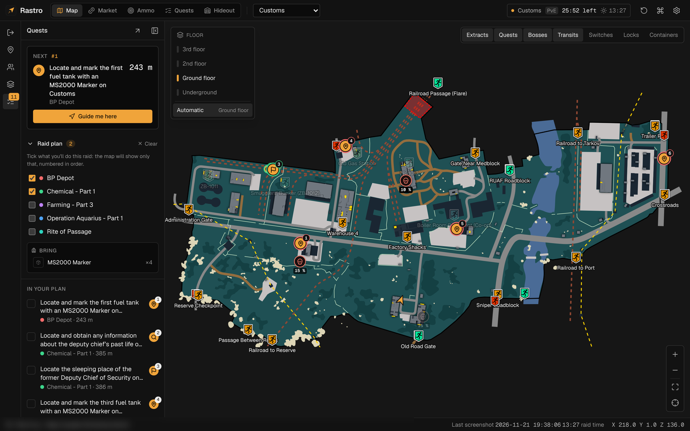

  

  🌐 <a href="README.md">English</a> · <a href="README.es.md">Español</a> · <a href="README.ru.md">Русский</a> · <a href="README.de.md">Deutsch</a> · <a href="README.pt-BR.md">Português</a> · <b>Français</b> · <a href="README.pl.md">Polski</a> · <a href="README.zh-CN.md">中文</a>
   
  Traduction de la communauté. En cas de différence avec le <a href="README.md">README en anglais</a>, c'est la version anglaise qui fait foi. Une erreur ? <a href="https://discord.gg/H4pRxGBGDb">Dites-le-nous sur Discord</a>.

  
  
  
  
  
  
  

<h3 align="center">
  <a href="https://github.com/MaxSala/rastro-tarkov/releases/latest/download/Rastro-windows-x64.exe">⬇ Télécharger Rastro pour Windows</a>
</h3>

Gratuit et open source · Sans installateur · Sans compte · Rien à configurer 
  Site web et guide complet : <a href="https://maxsala.github.io/rastro-tarkov/fr/"><b>maxsala.github.io/rastro-tarkov</b></a>

---

**Rastro est une carte en direct de votre raid pour votre second écran.** Faites une capture en jeu et votre position apparaît, avec le chemin vers chaque extraction. Vos quêtes, votre planque, les boss et votre escouade, sur le même écran, sans alt-tab.

Il ne touche jamais au jeu : il lit seulement des fichiers que Tarkov écrit déjà sur votre disque. Gratuit, open source, fait par des joueurs pour des joueurs.

  
   Customs en raid : votre position, un plan de raid avec son itinéraire, les boss et le temps restant.

<table>
  <tr><td width="50%" valign="top"> <b>Jouer en escouade</b> Tout le monde sur la même carte, chiffré de PC à PC. Sans serveur ni compte.</td><td width="50%" valign="top"> <b>Des quêtes qui suivent le jeu</b> Cochées depuis les journaux du jeu, avec chaque objectif en cours sur la carte.</td></tr>
  <tr><td width="50%" valign="top"> <b>Planque</b> Ce que demande le prochain niveau de chaque module, et ce qu'il ne faut pas vendre.</td><td width="50%" valign="top"> <b>Boss sur la carte</b> Où chaque boss peut apparaître et avec quelle probabilité, en PvP et PvE.</td></tr>
  <tr><td width="50%" valign="top"> <b>Horloge de raid</b> Temps restant, heure de Tarkov des deux côtés et fenêtre du train blindé.</td><td width="50%" valign="top"> <b>Prix et munitions</b> Prix du marché et des marchands, clés et chaque munition, consultables hors ligne.</td></tr>
</table>

## Est-ce sûr ?

- Lit seulement des fichiers que le jeu écrit sur le disque : les **noms** de vos captures et, si vous l'activez, les journaux.
- Ne lit jamais la mémoire du jeu, n'envoie aucune touche et ne dessine rien par-dessus le jeu.
- N'écoute que sur votre propre PC (`127.0.0.1`). Aucune télémétrie, aucun compte.
- Open source (MIT). Chaque version est compilée par GitHub Actions à partir de ce code.

La réponse complète, l'avertissement Windows SmartScreen et comment vérifier le fichier : [Questions et sécurité](docs/fr/FAQ.md).

## Pour commencer

1. **Téléchargez** [`Rastro-windows-x64.exe`](https://github.com/MaxSala/rastro-tarkov/releases/latest/download/Rastro-windows-x64.exe) et lancez-le. Rien à installer.
2. **Suivez la courte configuration.** Elle trouve votre dossier de captures et télécharge les cartes de tarkov.dev.
3. **Faites une capture en jeu.** Votre flèche apparaît sur la carte.

## En savoir plus

**[Site web](https://maxsala.github.io/rastro-tarkov/fr/)** · **[Fonctionnalités](docs/fr/FEATURES.md)** · **[Guide : installation, raccourcis et données](docs/fr/GUIDE.md)** · **[Questions et sécurité](docs/fr/FAQ.md)** · **[Feuille de route](docs/ROADMAP.md)** · **[Nouveautés](CHANGELOG.md)** · **[Contribuer](CONTRIBUTING.md)**

> [!TIP]
> Rastro est en bêta publique et se construit avec les joueurs qui l'utilisent. Partagez vos idées et signalez les bugs sur [Discord](https://discord.gg/H4pRxGBGDb) ou dans les [issues](https://github.com/MaxSala/rastro-tarkov/issues). S'il vous est utile, une ⭐ sur GitHub aide d'autres joueurs à le trouver.

---

Cartes des <a href="https://github.com/the-hideout/tarkov-dev-svg-maps">contributeurs de tarkov.dev</a>, CC BY-NC-SA 4.0. Prix et données des objets de <a href="https://tarkov.dev">tarkov.dev</a>. Les captures de la squad utilisent des positions d'exemple. Les captures montrent l'application en anglais.
 *Escape from Tarkov* est une marque de Battlestate Games. Rastro n'est ni affilié à Battlestate Games ou à tarkov.dev, ni soutenu par eux.
 Licence MIT · [Crédits et licences tierces](NOTICE.md)
