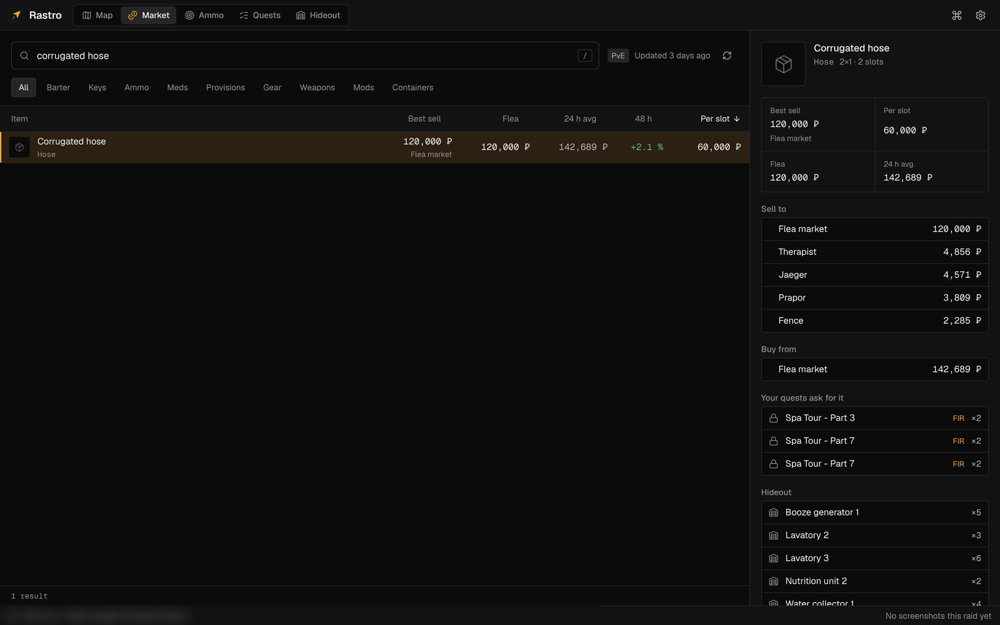

<p align="center">
  
</p>

<p align="center">
  <a href="https://github.com/MaxSala/rastro-tarkov/releases/latest"></a>
  <a href="https://discord.gg/H4pRxGBGDb"></a>
  
  <a href="LICENSE"></a>
</p>

<h3 align="center">
  <a href="https://github.com/MaxSala/rastro-tarkov/releases/latest/download/Rastro-windows-x64.exe">⬇ Download Rastro for Windows</a>
</h3>

<p align="center">
  Free and open source · No installer · No account · Nothing to configure
  <br>
  <a href="#how-it-works">How it works</a> ·
  <a href="#play-with-your-squad">Squad mode</a> ·
  <a href="#is-it-safe">Is it safe?</a> ·
  <a href="#install">Install</a> ·
  <a href="https://discord.gg/H4pRxGBGDb">Discord</a>
</p>

---

**Rastro is a live map of your raid that runs on your second monitor.** Take a screenshot in game and your position appears on the map, with the distance and direction to every extract. Open a room and your squad sees each other on the same map, on every PC. Hover a locked door to see which key opens it and what it costs. Check prices and ammo without alt-tabbing to a browser.

It never touches the game. Rastro only reads files Tarkov already writes to your disk, and it's free, open source and made by players for players.

## Screenshots

<table>
  <tr>
    <td width="50%"></td>
    <td width="50%"></td>
  </tr>
  <tr>
    <td align="center"><b>Squad.</b> Everyone's position and heading on one map, with pings. No server in between.</td>
    <td align="center"><b>Map.</b> Your position and trail, every extract, and live distance and direction to the one you pick.</td>
  </tr>
  <tr>
    <td width="50%"></td>
    <td width="50%"></td>
  </tr>
  <tr>
    <td align="center"><b>Floors.</b> Follows you between floors and fades out everything that isn't on yours.</td>
    <td align="center"><b>Keys.</b> Every locked door on the map, which key opens it and what it costs.</td>
  </tr>
  <tr>
    <td width="50%"></td>
    <td width="50%"></td>
  </tr>
  <tr>
    <td align="center"><b>Market.</b> Instant offline search with flea and trader prices, sorted by value per slot.</td>
    <td align="center"><b>Ammo.</b> Damage, penetration and armor damage for every round, with the cheapest place to buy it.</td>
  </tr>
</table>

<sub>Map imagery by the <a href="https://github.com/the-hideout/tarkov-dev-svg-maps">tarkov.dev contributors</a>, CC BY-NC-SA 4.0. Prices and item data from <a href="https://tarkov.dev">tarkov.dev</a>. Squad screenshots use example positions.</sub>

## How it works

Rastro reads two kinds of files that Escape from Tarkov already saves on your PC. It doesn't need anything else.

| What it reads | Where | What Rastro gets from it |
|---|---|---|
| **The file names of your screenshots** | `Documents\Escape from Tarkov\Screenshots` | Your position and the direction you're facing. Tarkov writes your coordinates into the name of every screenshot it saves. Rastro reads the name, never the picture, and never moves, edits or deletes your screenshots. |
| **The game's log files** (optional, off until you turn it on) | `Battlestate Games\Escape from Tarkov\Logs` | Which map is loading, when a raid starts and whether you're playing PvP or PvE. Rastro uses that to switch to the right map by itself, start a fresh trail every raid and show how much raid time is left. Only the map name and game mode are kept. |

So in practice: you press your screenshot key in game, and a second later your arrow moves on the map.

What Rastro **doesn't** do: it doesn't read game memory, inject anything, hook into the game process, capture network traffic, draw over the game or press keys for you. It runs as a separate program and only looks at files on disk.

## Play with your squad

Rastro's party mode puts your whole squad on the same map, each with their own name and colour.

- **See where everyone is.** Every teammate's arrow shows where they were and which way they were facing at their last screenshot. If someone is on a different floor, their arrow fades out and hovering it tells you which floor they're on.
- **Ping a spot.** `Shift` + click anywhere on the map and the spot flashes on everyone's screen.
- **Easy to set up.** One player opens a room and copies an invite code. The others paste it under *Join*. That's it. Up to 8 players.
- **No server, no account.** Positions go straight from PC to PC. Nobody else, including us, ever sees them.
- **Encrypted.** All traffic is end-to-end encrypted with the [Noise protocol](https://noiseprotocol.org/). The invite code is the key, so only share it with your squad.

The host needs to be reachable by the others. The easiest way is a free mesh VPN such as [Tailscale](https://tailscale.com/) or [ZeroTier](https://www.zerotier.com/): everyone installs it once and Rastro works as if you were on the same network, with no ports to open on your router. Opening a port on the host's router works too.

Each player still runs Rastro on their own PC and takes their own screenshots: that's what keeps everyone's position up to date.

## Features

**Map**
- Your position and heading, updated every time you take a screenshot, with a fading trail of where you've been.
- Click an extract or any point to get the distance, which way to turn and the height difference.
- Extracts filtered by PMC, Scav or shared. Mark the ones the game says are open this raid and the rest fade out.
- Layers from tarkov.dev: transits, switches, loot containers (filterable by type) and locks.
- Multi-level maps follow you between floors automatically, or you pick one in the floor panel. The rest of the map and everything on other floors is dimmed.
- Hover anything for a card with what it is, how far it is, which floor it's on and what clicking does.
- Your own points: right-click the map to save loot spots, danger areas, stashes or quest locations. They're stored in game coordinates, so they survive reinstalling a map.

**Keys**
- The *Locks* layer shows every door, container and car trunk that needs a key. Locks that need power have a yellow outline.
- Click a lock to see which key opens it, the cheapest place to buy it and its best sell price.
- *Highlight this key* dims every other lock, so you can see everything a single key opens.
- Every key in the Market lists the installed maps it's used on, with a link that jumps straight there.

**Market**
- Search the full item catalog by name or short name. Accents and word order don't matter. Press `/` to search and the arrow keys to move through results.
- Sort by best sell, flea price, 24-hour average, 48-hour change or price per inventory slot.
- Each item lists every trader and flea offer, with the trader level required and the original price in dollars or euros.
- The catalog is downloaded once and searched on your PC, so lookups are instant and work offline.

**Ammo**
- Every round grouped by caliber and sorted by penetration.
- Damage (per pellet × pellets for buckshot), penetration, armor damage, fragmentation chance, muzzle velocity and the cheapest place to buy it. Tracers are marked.

**Raid detection** (optional)
- Switches to the right map when a raid loads, resets your trail and marks at the start of each raid, and shows the time left. Reads the game's log files, as described in [How it works](#how-it-works).

**Everything else**
- 16 languages, the same ones tarkov.dev supports: Čeština, Deutsch, English, Español, Français, Magyar, Italiano, 日本語, 한국어, Polski, Português, Română, Русский, Slovenčina, Türkçe and 中文. Item, map and extract names follow your language too.
- PvP and PvE data, picked automatically from the game logs or by hand.
- Optional update notifications and a *What's new* page after every update.
- Keyboard shortcuts for everything, and a command palette (`Ctrl+K`).

## Is it safe?

Rastro is a small, portable program. Here's what that means and how you can check it.

- **No installer, no admin rights.** It's a single `.exe`. It doesn't install services or drivers, doesn't start with Windows and doesn't touch the game's files. Its settings and downloaded maps live in one folder (see [Where your data lives](#where-your-data-lives)), and deleting that folder and the `.exe` removes it completely.
- **Open source.** All the code is in this repository. Anyone can read it.
- **Built in public.** Every release is built by GitHub's own servers straight from the source code, not on someone's PC. You can see each build in the [Actions](https://github.com/MaxSala/rastro-tarkov/actions) tab, and the release page lists the file's SHA-256 so you can check you got exactly that file:

  ```powershell
  Get-FileHash .\Rastro-windows-x64.exe
  ```

- **Doesn't phone home.** No telemetry, no ads, no account. It only connects to the internet when you ask it to, and the full list of connections is in [Privacy](#privacy-and-network-use).

**"Windows protected your PC."** The first time you open Rastro, Windows SmartScreen will most likely show a blue window saying it stopped an unrecognised app. This happens with any new program that isn't signed with a paid certificate, not because something is wrong with the file. Click **More info**, then **Run anyway**. Windows remembers your choice. Some antivirus programs are wary of new unsigned programs too. If yours flags Rastro, you can restore it and add an exception, upload the file to [VirusTotal](https://www.virustotal.com/) to get a second opinion, and report it as a false positive to your antivirus vendor.

> [!IMPORTANT]
> Rastro is an unofficial fan project, not affiliated with or endorsed by Battlestate Games or tarkov.dev. It's built to stay out of the game: it only reads files on disk and never interacts with the game process. Even so, using third-party tools with Escape from Tarkov is your own responsibility under Battlestate Games' terms of service.

## Install

1. **[Download `Rastro-windows-x64.exe`](https://github.com/MaxSala/rastro-tarkov/releases/latest/download/Rastro-windows-x64.exe)**. This link always gets the latest version.
2. Put it wherever you like: your desktop, a folder in Documents, anywhere. It doesn't need any other file next to it.
3. Double-click it. If Windows shows a blue warning, see [Is it safe?](#is-it-safe).

Requires Windows 10 or 11, 64-bit.

### First launch

A short guide opens the first time:

1. **Screenshots folder.** Rastro finds `Documents\Escape from Tarkov\Screenshots` on its own, including when Windows has moved Documents into OneDrive. If it can't, paste the path and it tells you how many screenshots with coordinates it sees. Here you can also turn on raid detection.
2. **Maps.** Download the community maps from tarkov.dev (recommended), import a map pack, or try the demo map.
3. Done. Take a screenshot in game and your arrow appears on the map.

To use the Market, the Ammo table and key names, open the Market tab once and press *Download prices*.

### Updating

If you allowed update checks, a button appears in the top bar when a new version is out and takes you to its download page. Otherwise, download the new `.exe` from the [link above](#install), close Rastro and use the new file instead of the old one. Your settings, points, maps and prices are kept [separately](#where-your-data-lives), so nothing is lost.

After updating, Rastro shows what changed. The full history is in *Settings → About → What's new* and in [CHANGELOG.md](CHANGELOG.md). If an update adds new map data, use *Update from tarkov.dev* in the Maps panel to get it.

### Shortcuts

| Action | How |
|---|---|
| Update your position | Take a screenshot in game |
| Switch section (Map, Market, Ammo) | `Ctrl+1`, `Ctrl+2`, `Ctrl+3` |
| Command palette | `Ctrl+K` |
| Extracts, points, party and maps panels | `1`, `2`, `3`, `4` |
| New raid (clear trail and marks) | `N` |
| Fit the whole map / follow your position | `F` / `G` |
| Zoom | `+` / `-` or the mouse wheel |
| Add a point, guide to a place | Right-click on the map |
| Ping your squad | `Shift` + click |
| Search the Market | `/` |
| Settings | `,` |

### Where your data lives

Settings, your points, downloaded maps and the price cache are kept in one folder, separate from the `.exe`:

| System | Folder |
|---|---|
| Windows | `%APPDATA%\Rastro\data\` |
| Linux | `~/.local/share/rastro/` |
| macOS | `~/Library/Application Support/Rastro/` |

*Settings → Log* has a button to open it.

### If something doesn't work

- **It opens in my browser instead of its own window.** Rastro uses Microsoft WebView2 to draw its window. It ships with Windows 10 and 11, but if it was removed, Rastro falls back to your browser. Installing the [WebView2 Runtime](https://developer.microsoft.com/microsoft-edge/webview2/) brings the window back.
- **An error page says the port is already in use.** Another copy of Rastro is probably still running. Close it from the taskbar or from Task Manager (look for `rastro.exe`) and open it again.
- **My position never moves.** Check that the screenshots folder in *Settings → General* is the one the game actually saves to, and that you're pressing the in-game screenshot key.
- **My teammates can't join my room.** They need to reach your PC. Use the address from your mesh VPN (Tailscale, ZeroTier) when you open the room, or open the party port on your router.
- **Still stuck?** Ask on [Discord](https://discord.gg/H4pRxGBGDb). *Settings → Log* has a *Copy* button, and pasting that log helps a lot.

## Questions

**Can I get banned for using it?**
Rastro never reads game memory, never touches the game process and never sends input to the game. It reads screenshot file names and log files after the game has written them, the same files you can open yourself in Explorer. We can't speak for Battlestate Games, though, so see the note in [Is it safe?](#is-it-safe).

**Does it work in PvE?**
Yes. Raid detection has been tested with PvE logs, and Rastro downloads PvE prices and data when it detects PvE.

**Does it need the internet?**
Only to download maps and prices, check for updates (if you allow it) and play in a squad. Everything else works offline.

**Why screenshots?**
They're the only place the game writes your exact position to disk. It's a few seconds of delay in exchange for never touching the game.

**Linux or macOS?**
Rastro builds and runs on Linux; macOS is untested. Tarkov itself runs on Windows, so the download is Windows only. See [Building from source](#building-from-source).

## Privacy and network use

Rastro has no account, no telemetry and no ads. The interface talks only to the app itself on `127.0.0.1`, protected by a random key that changes on every launch. Everything it reads from your disk stays on your PC. Anything else happens only when you ask for it:

| When | Connects to |
|---|---|
| Always | Nothing outside your PC |
| You download maps from tarkov.dev | `raw.githubusercontent.com`, `json.tarkov.dev` and, as a fallback, `api.tarkov.dev` |
| You download or refresh prices | `json.tarkov.dev`, plus `assets.tarkov.dev` for item icons |
| You import a map pack from a URL | Only the address you enter (HTTPS only, never internal addresses) |
| You host or join a party | Directly to your teammates' PCs |
| Once per launch, if you said yes to update checks (or when you press *Check now*) | `api.github.com`, to read the latest version number. Nothing about you is sent. |

Every download host is on a fixed allowlist, also checked on redirects, and everything downloaded is validated before use. The full threat model is in [docs/SECURITY.md](docs/SECURITY.md).

## Community

Questions, bug reports, feature ideas or looking for a squad to try party mode with: join the **[Rastro Discord](https://discord.gg/H4pRxGBGDb)**. It's also where development happens day to day, so it's the best place to see what's coming and to help with translations. Bug reports and pull requests are welcome here on GitHub too.

## Credits

Rastro would not exist without **[tarkov.dev](https://tarkov.dev)**, the open-source Escape from Tarkov database maintained by the **[The Hideout](https://github.com/the-hideout)** community. tarkov.dev began as [tarkov-tools](https://github.com/kokarn/tarkov-tools) by **Oskar Risberg ([@kokarn](https://github.com/kokarn))** and was revived and opened up by The Hideout's contributors. Rastro uses:

- **Maps:** the SVG maps from [the-hideout/tarkov-dev-svg-maps](https://github.com/the-hideout/tarkov-dev-svg-maps) by tarkov.dev's contributors, licensed [CC BY-NC-SA 4.0](https://creativecommons.org/licenses/by-nc-sa/4.0/). Their authors don't allow the maps to be used in cheats or software that gives an unfair advantage, such as radars. Maps are downloaded by you and never redistributed with Rastro, and each installed map keeps its credits and license.
- **Data:** extracts, transits, switches, containers, locks, items, prices and translations from the tarkov.dev API and its data files.
- **Marker icons:** from [tarkov-dev](https://github.com/the-hideout/tarkov-dev) (`public/maps/interactive`), MIT License, © 2019 Oskar Risberg.
- **Item icons** belong to Battlestate Games and are only cached locally for display.

If you find Rastro useful, consider supporting tarkov.dev, contributing to it or joining their community.

Rastro is also built on many other open-source projects, including Rust, Tokio, Axum, Snow, Rustls, Wry, React, Leaflet, Tailwind CSS and the Geist typeface. The full list with licenses is in [NOTICE.md](NOTICE.md).

*Escape from Tarkov* is a trademark of Battlestate Games. Game content and materials are trademarks and copyrights of Battlestate Games and its licensors.

## Non-commercial

Rastro is a hobby project made for the community. It's free, there's no paid version, it shows no ads and collects no data. It will stay that way, both by choice and because the tarkov.dev maps it relies on are licensed for non-commercial use only.

## Known limitations

- Your position only updates when you take a screenshot. That's by design: it's the only place the game writes your position.
- Labs has no SVG map on tarkov.dev. Rastro recognises it, but can't show it unless you import your own map pack.
- Raid detection has been verified with PvE logs. PvP should behave the same, but hasn't been confirmed with real logs.
- Spanish and English translations are reviewed. The other 14 haven't been checked by native speakers yet. Corrections are very welcome, here or on [Discord](https://discord.gg/H4pRxGBGDb).
- Changing the language or game mode (PvP/PvE) needs a fresh download of maps and prices to see the new names.
- Some technical details inside error messages and the log are in English whatever language you pick.

## Building from source

You only need this if you want to change the code or build the `.exe` yourself.

**Requirements:** [Rust](https://rustup.rs/) 1.85 or newer and [Node.js](https://nodejs.org/) LTS. On Linux, also `libwebkit2gtk-4.1-dev` and `libgtk-3-dev`.

```sh
git clone https://github.com/MaxSala/rastro-tarkov.git
cd rastro-tarkov
```

On Windows, run `build.bat`. On Linux or macOS, run `./build.sh`. Both build the web interface first and then the app, which embeds it. The result is a single executable: `target\release\rastro.exe` on Windows, `target/release/rastro` elsewhere.

Maintainers: how to publish a new version is described in [docs/RELEASING.md](docs/RELEASING.md).

## Development

```sh
cd web && npm ci && npm run dev    # terminal 1: Vite dev server on 127.0.0.1:5173
cargo run -- --dev                 # terminal 2: backend; opens the browser with the session key
```

`--dev` only widens the accepted origins to `localhost:5173`. Don't use it to play.

Before sending changes:

```sh
cargo fmt --check
cargo clippy --all-targets
cargo test
cd web && npm run typecheck && npm run lint && npm run format:check
```

Dependencies are pinned to exact versions, `cargo deny check` and `cargo audit` cover the Rust side, and npm runs with `ignore-scripts=true`.

### Project layout

```
src/          Rust backend: screenshot watcher, local server, map packs, party, market, game logs
web/          Interface: React, TypeScript, Leaflet and Tailwind
  src/locales/  One folder per language
assets/       Logo, app icon and the demo map
docs/         Security model, protocol, map pack format and roadmap
```

Technical documentation lives in `docs/`: [security model](docs/SECURITY.md), [interface protocol](docs/PROTOCOL.md), [map pack format](docs/MAP_PACK.md), [roadmap](docs/ROADMAP.md) and [release process](docs/RELEASING.md).

### Translations

Each language lives in `web/src/locales/<code>/` (`main.ts`, `game.ts` and `tools.ts`) and is type-checked against the Spanish files, so a missing key won't compile. To fix a translation, edit the file and open a pull request, or point it out in the `#translations` channel on [Discord](https://discord.gg/H4pRxGBGDb).

## License

Rastro's source code is released under the [MIT License](LICENSE). Maps and data downloaded from tarkov.dev keep their own licenses, listed under [Credits](#credits) and in [NOTICE.md](NOTICE.md).
