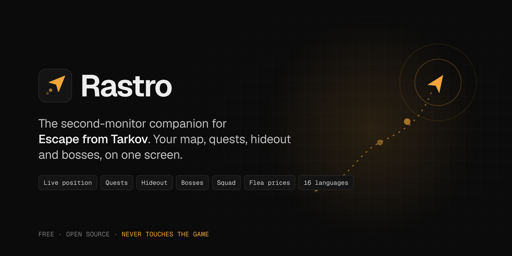
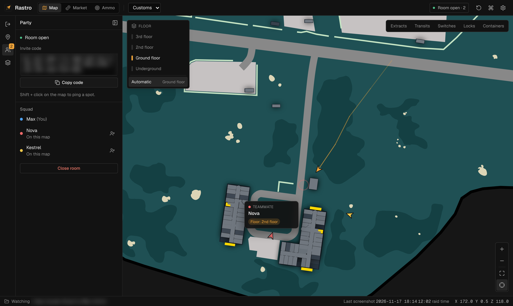

<p align="center">
  
</p>

<p align="center">
  🌐 <a href="README.md">English</a> · <a href="README.es.md">Español</a> · <a href="README.ru.md">Русский</a> · <a href="README.de.md">Deutsch</a> · <a href="README.pt-BR.md">Português</a> · <a href="README.fr.md">Français</a> · <b>Polski</b> · <a href="README.zh-CN.md">中文</a>
  <br>
  <sub>Tłumaczenie społeczności. Jeśli coś różni się od <a href="README.md">angielskiego README</a>, aktualna jest wersja angielska. Widzisz błąd? <a href="https://discord.gg/H4pRxGBGDb">Daj nam znać na Discordzie</a>.</sub>
</p>

<p align="center">
  <a href="https://github.com/MaxSala/rastro-tarkov/releases/latest"></a>
  
  <a href="https://github.com/MaxSala/rastro-tarkov/stargazers"></a>
  <a href="https://discord.gg/H4pRxGBGDb"></a>
  
  <a href="LICENSE"></a>
</p>

<h3 align="center">
  <a href="https://github.com/MaxSala/rastro-tarkov/releases/latest/download/Rastro-windows-x64.exe">⬇ Pobierz Rastro dla Windows</a>
</h3>

<p align="center">
  Darmowy i open source · Bez instalatora · Bez konta · Nic do konfigurowania
  <br>
  <a href="#jak-to-działa">Jak to działa</a> ·
  <a href="#graj-z-drużyną">Tryb drużyny</a> ·
  <a href="#czy-to-bezpieczne">Czy to bezpieczne?</a> ·
  <a href="#instalacja">Instalacja</a> ·
  <a href="#dokąd-zmierza-rastro">Plany</a> ·
  <a href="#dołącz-do-nas">Dołącz do nas</a> ·
  <a href="https://discord.gg/H4pRxGBGDb">Discord</a>
</p>

> [!TIP]
> **Rastro jest w publicznej becie i to dopiero początek.** Zadania właśnie dotarły; kryjówka, zadania drużynowe i dużo więcej są w drodze, a o tym, co pojawi się najpierw, decyduje społeczność.
> Jeśli podoba ci się ten kierunek, **[⭐ daj gwiazdkę repozytorium](https://github.com/MaxSala/rastro-tarkov/stargazers)** i **[dołącz do Discorda](https://discord.gg/H4pRxGBGDb)**. To pięć sekund, a pomaga bardziej, niż myślisz.

---

**Rastro to mapa twojego rajdu na żywo, działająca na drugim monitorze.** Zrób zrzut ekranu w grze, a twoja pozycja pojawi się na mapie razem z odległością i kierunkiem do każdej ewakuacji. Otwórz pokój, a cała drużyna widzi się na tej samej mapie, każdy na swoim PC. Najedź kursorem na zamknięte drzwi, żeby zobaczyć, jaki klucz je otwiera i ile kosztuje. Śledź swoje zadania z każdym otwartym celem na mapie. Sprawdzaj ceny i amunicję bez alt-tabowania do przeglądarki.

Rastro nigdy nie dotyka gry. Czyta tylko pliki, które Tarkov i tak zapisuje na dysku. Jest darmowy, open source i zrobiony przez graczy dla graczy.

## Zrzuty ekranu

<table>
  <tr>
    <td width="50%"></td>
    <td width="50%"></td>
  </tr>
  <tr>
    <td align="center"><b>Drużyna.</b> Pozycja i kierunek patrzenia wszystkich na jednej mapie, z pingami. Bez serwera pośrodku.</td>
    <td align="center"><b>Mapa.</b> Twoja pozycja i ślad, wszystkie ewakuacje oraz odległość i kierunek na żywo do wybranej.</td>
  </tr>
  <tr>
    <td width="50%"></td>
    <td width="50%"></td>
  </tr>
  <tr>
    <td align="center"><b>Piętra.</b> Podąża za tobą między piętrami i przyciemnia wszystko, co nie jest na twoim.</td>
    <td align="center"><b>Klucze.</b> Wszystkie zamknięte drzwi na mapie, jaki klucz je otwiera i ile kosztuje.</td>
  </tr>
  <tr>
    <td width="50%"></td>
    <td width="50%"></td>
  </tr>
  <tr>
    <td align="center"><b>Rynek.</b> Błyskawiczne wyszukiwanie offline z cenami z pchlego targu i od handlarzy, sortowane według wartości za slot.</td>
    <td align="center"><b>Amunicja.</b> Obrażenia, penetracja i obrażenia pancerza każdego naboju, z najtańszym miejscem zakupu.</td>
  </tr>
</table>

<sub>Mapy autorstwa <a href="https://github.com/the-hideout/tarkov-dev-svg-maps">współtwórców tarkov.dev</a>, CC BY-NC-SA 4.0. Ceny i dane przedmiotów z <a href="https://tarkov.dev">tarkov.dev</a>. Zrzuty drużyny używają przykładowych pozycji. Zrzuty pokazują aplikację po angielsku.</sub>

## Dokąd zmierza Rastro

Rastro zaczął się jako mapa na drugim monitorze, żeby już nigdy się nie zgubić. Plan jest dużo większy: **jedna aplikacja-towarzysz do wszystkiego, co sprawdzasz między rajdami i w ich trakcie**, nadal bez dotykania gry. Oto, co jest na stole:

| | Co dalej | Co to da tobie |
|---|---|---|
| 👥 | **Zadania drużyny** | Niewykonane zadania kolegów na tej samej mapie, żeby drużyna mogła zaplanować jedną trasę dla wszystkich. |
| 🏠 | **Śledzenie kryjówki** | Każde ulepszenie, czego wymaga i które przedmioty zachować. Koniec ze sprzedawaniem dziś tego, czego jutro będziesz potrzebować. |
| 🔑 | **Twój pęk kluczy** | Zaznacz klucze, które masz, a drzwi, które możesz otworzyć, wyróżnią się na każdej mapie. |
| 🛒 | **Lista zakupów** | Ulubione przedmioty i powiadomienie, gdy zmieni się ich cena. |
| 📊 | **Historia rajdów** | Mapa, czas trwania, czas w kolejce i tryb gry każdego rajdu. |
| 🎯 | **Amunicja kontra pancerz** | Wykres penetracji każdego naboju przeciwko każdej klasie pancerza. |
| 📍 | **Udostępnianie punktów** | Wyślij drużynie swoje miejsca z lootem i skrytki albo przenieś je na inny PC. |

Nic z tego nie ma jeszcze daty, a kolejność nie jest ustalona: **wyznaczają ją prośby graczy.** Pełna lista, z mniejszymi pomysłami i tym, co już wyszło, jest w [docs/ROADMAP.md](docs/ROADMAP.md) (po angielsku).

**Masz pomysł?** Wrzuć go na forum feature requests na [Discordzie](https://discord.gg/H4pRxGBGDb) albo [otwórz issue](https://github.com/MaxSala/rastro-tarkov/issues). Czytamy każdą propozycję, a najczęściej zgłaszane idą w górę listy.

## Jak to działa

Rastro czyta dwa rodzaje plików, które Escape from Tarkov i tak zapisuje na twoim PC. Nic więcej nie potrzebuje.

| Co czyta | Gdzie | Co z tego wyciąga |
|---|---|---|
| **Nazwy twoich zrzutów ekranu** | `Documents\Escape from Tarkov\Screenshots` | Twoją pozycję i kierunek, w którym patrzysz. Tarkov zapisuje twoje współrzędne w nazwie każdego zrzutu. Rastro czyta nazwę, nigdy obraz, i nigdy nie przenosi, nie edytuje ani nie usuwa twoich zrzutów. |
| **Logi gry** (opcjonalne, wyłączone, dopóki ich nie włączysz) | `Battlestate Games\Escape from Tarkov\Logs` | Która mapa się wczytuje, kiedy zaczyna się rajd i czy grasz w PvP czy PvE. Dzięki temu Rastro sam przełącza się na właściwą mapę, zaczyna nowy ślad w każdym rajdzie i pokazuje pozostały czas rajdu. Zapisywane są tylko nazwa mapy i tryb gry. Czyta też wiadomości handlarzy, by odhaczać zadania, które przyjmiesz, oddasz lub oblejesz. |

W praktyce: wciskasz w grze klawisz zrzutu ekranu, a sekundę później twoja strzałka przesuwa się na mapie.

Czego Rastro **nie** robi: nie czyta pamięci gry, niczego nie wstrzykuje, nie podpina się pod proces gry, nie przechwytuje ruchu sieciowego, nie rysuje niczego na grze ani nie naciska za ciebie klawiszy. Działa jako osobny program i patrzy tylko na pliki na dysku.

## Graj z drużyną

Tryb drużyny w Rastro umieszcza całą twoją drużynę na tej samej mapie, każdego z własną nazwą i kolorem.

- **Widzisz, gdzie jest każdy.** Strzałka każdego kolegi pokazuje, gdzie był i w którą stronę patrzył przy ostatnim zrzucie. Jeśli ktoś jest na innym piętrze, jego strzałka jest przyciemniona, a po najechaniu widać, na którym.
- **Pinguj miejsce.** `Shift` + klik w dowolne miejsce mapy, a to miejsce zamiga na ekranie każdego.
- **Łatwa konfiguracja.** Jeden gracz otwiera pokój i kopiuje kod zaproszenia. Reszta wkleja go w *Dołącz*. I tyle. Do 8 graczy.
- **Bez serwera i konta.** Pozycje idą prosto z PC do PC. Nikt inny ich nie widzi, nawet my.
- **Szyfrowanie.** Cały ruch jest szyfrowany end-to-end [protokołem Noise](https://noiseprotocol.org/). Kod zaproszenia jest kluczem, więc udostępniaj go tylko swojej drużynie.

Pozostali muszą mieć dostęp do PC hosta. Najprościej użyć darmowego VPN typu mesh, jak [Tailscale](https://tailscale.com/) albo [ZeroTier](https://www.zerotier.com/): każdy instaluje go raz, a Rastro działa tak, jakbyście byli w jednej sieci, bez otwierania portów na routerze. Otwarcie portu na routerze hosta też zadziała.

Każdy gracz i tak uruchamia Rastro na swoim PC i robi własne zrzuty: dzięki temu pozycje wszystkich są aktualne.

## Funkcje

**Mapa**
- Twoja pozycja i kierunek, aktualizowane przy każdym zrzucie ekranu, z zanikającym śladem przebytej drogi.
- Kliknij ewakuację lub dowolny punkt, żeby zobaczyć odległość, w którą stronę skręcić i różnicę wysokości.
- Ewakuacje filtrowane na PMC, Scav i wspólne. Zaznacz te, które gra pokazuje jako otwarte w tym rajdzie, a reszta zostanie przyciemniona.
- Warstwy z tarkov.dev: przejścia, przełączniki, pojemniki z lootem (z filtrem typu) i zamki.
- Mapy z kilkoma piętrami same za tobą podążają albo wybierasz piętro w panelu pięter. Reszta mapy i wszystko na innych piętrach jest przyciemnione.
- Najedź na cokolwiek, żeby zobaczyć kartę z nazwą, odległością, piętrem i tym, co robi kliknięcie.
- Własne punkty: prawy klik na mapie, żeby zapisać miejsca z lootem, niebezpieczne strefy, skrytki albo miejsca zadań. Zapisują się we współrzędnych gry, więc przetrwają ponowną instalację mapy.

**Zadania**
- Wszystkie zadania w twoim języku: te w toku, te, które możesz już zacząć, a przy reszcie dokładnie to, czego brakuje (twój poziom albo wcześniejsze zadania). Filtruj według handlarza, mapy lub Kappy albo szukaj zadań, celów i przedmiotów.
- **Zadania podążają za grą.** Przy włączonym wykrywaniu rajdu zadania, które przyjmiesz, oddasz lub oblejesz, odhaczają się same z logów gry, osobno dla PvP i PvE. Za pierwszym razem Rastro czyta wszystkie uruchomienia zachowane przez grę, więc w połowie wipe'a od razu nadrabiasz postęp. Brak logów? *Nadrób postęp*, wybierając ostatnie zadanie u każdego handlarza.
- Każde zadanie pokazuje handlarza, swój obrazek i nagrody: doświadczenie, reputację, przedmioty oraz oferty i receptury, które odblokowuje.
- Twoje otwarte cele na mapie, uczciwie wobec danych: znaczek dla dokładnego miejsca, prawdziwy obrys dla obszaru i małe kropki dla miejsc, gdzie przedmiot *może* się pojawić. Kliknij, a Rastro cię poprowadzi jak do ewakuacji. Złe miejsce? *Złe miejsce?* zgłasza je jednym kliknięciem.
- **Plan rajdu** w panelu *Zadania*: zaznacz, co zrobisz w tym rajdzie, a mapa pokaże tylko to, ponumerowane wzdłuż najkrótszej trasy, razem z tym, co zabrać. *Następne* pokazuje duży kolejny cel; *Do oddania* — to, co gotowe.
- Zadania według handlarzy, jak w grze, z postępem Kappy i Lightkeepera, mapą, na której zrobisz najwięcej, oraz *Przedmiotami*: tym, czego twoje zadania jeszcze wymagają, żebyś tego nie sprzedał.

**Klucze**
- Warstwa *Zamki* pokazuje wszystkie drzwi, pojemniki i bagażniki, które wymagają klucza. Zamki wymagające prądu mają żółtą obwódkę.
- Kliknij zamek, żeby zobaczyć, jaki klucz go otwiera, gdzie kupić go najtaniej i za ile najlepiej sprzedać.
- *Wyróżnij ten klucz* przyciemnia wszystkie inne zamki, żeby było widać wszystko, co otwiera jeden klucz.
- Każdy klucz na Rynku pokazuje zainstalowane mapy, na których się przydaje, z linkiem prosto do nich.

**Rynek**
- Przeszukuj cały katalog przedmiotów po nazwie albo nazwie skróconej. Polskie znaki i kolejność słów nie mają znaczenia. Wciśnij `/`, żeby szukać, i strzałki, żeby poruszać się po wynikach.
- Sortuj po najlepszej cenie sprzedaży, cenie na pchlim targu, średniej z 24 godzin, zmianie z 48 godzin albo cenie za slot ekwipunku.
- Każdy przedmiot pokazuje wszystkie oferty handlarzy i pchlego targu, z wymaganym poziomem handlarza i ceną oryginalną w dolarach albo euro.
- Katalog pobiera się raz i przeszukuje na twoim PC, więc wyszukiwanie jest natychmiastowe i działa offline.

**Amunicja**
- Wszystkie naboje pogrupowane według kalibru i posortowane według penetracji.
- Obrażenia (na śrucinę × liczba śrucin dla śrutu), penetracja, obrażenia pancerza, szansa fragmentacji, prędkość wylotowa i najtańsze miejsce zakupu. Smugacze są oznaczone.

**Wykrywanie rajdu** (opcjonalne)
- Przełącza na właściwą mapę, gdy rajd się wczytuje, czyści ślad i znaczniki na początku każdego rajdu i pokazuje pozostały czas. Czyta logi gry, jak opisano w [Jak to działa](#jak-to-działa).

**Cała reszta**
- 16 języków, tych samych co w tarkov.dev: Čeština, Deutsch, English, Español, Français, Magyar, Italiano, 日本語, 한국어, Polski, Português, Română, Русский, Slovenčina, Türkçe i 中文. Nazwy przedmiotów, map i ewakuacji też są w twoim języku. Po zmianie języka Rastro zaproponuje przełączenie map, cen i zadań.
- Dane PvP i PvE, wybierane automatycznie na podstawie logów gry albo ręcznie.
- Opcjonalne powiadomienia o aktualizacjach i strona *Co nowego* po każdej aktualizacji.
- Skróty klawiszowe do wszystkiego i paleta poleceń (`Ctrl+K`).

## Czy to bezpieczne?

Rastro to mały, przenośny program. Oto co to oznacza i jak możesz to sprawdzić.

- **Bez instalatora i uprawnień administratora.** To jeden plik `.exe`. Nie instaluje usług ani sterowników, nie uruchamia się z Windowsem i nie rusza plików gry. Ustawienia i pobrane mapy trzyma w jednym folderze (zobacz [Gdzie są twoje dane](#gdzie-są-twoje-dane)), a usunięcie tego folderu i pliku `.exe` usuwa go całkowicie.
- **Open source.** Cały kod jest w tym repozytorium. Każdy może go przeczytać.
- **Budowany publicznie.** Każdą wersję budują serwery GitHuba prosto z kodu źródłowego, a nie czyjś PC. Każdy build widać w zakładce [Actions](https://github.com/MaxSala/rastro-tarkov/actions), a strona wydania podaje SHA-256 pliku, żebyś mógł sprawdzić, że masz dokładnie ten plik:

  ```powershell
  Get-FileHash .\Rastro-windows-x64.exe
  ```

- **Niczego nie wysyła.** Bez telemetrii, reklam i konta. Łączy się z internetem tylko wtedy, gdy o to poprosisz, a pełna lista połączeń jest w sekcji [Prywatność](#prywatność-i-sieć).

**„System Windows ochronił ten komputer".** Przy pierwszym uruchomieniu Windows SmartScreen najpewniej pokaże niebieskie okno z informacją, że zatrzymał nierozpoznaną aplikację. Dzieje się tak z każdym nowym programem bez płatnego certyfikatu, a nie dlatego, że z plikiem jest coś nie tak. Kliknij **Więcej informacji**, a potem **Uruchom mimo to**. Windows zapamięta twój wybór. Niektóre antywirusy też podchodzą nieufnie do nowych, niepodpisanych programów. Jeśli twój oznaczy Rastro, możesz go przywrócić i dodać wyjątek, wrzucić plik na [VirusTotal](https://www.virustotal.com/) dla drugiej opinii i zgłosić fałszywy alarm producentowi antywirusa.

> [!IMPORTANT]
> Rastro to nieoficjalny projekt fanowski, niezwiązany z Battlestate Games ani tarkov.dev i nieautoryzowany przez nich. Jest zbudowany tak, żeby trzymać się z dala od gry: czyta tylko pliki z dysku i nigdy nie wchodzi w interakcję z procesem gry. Mimo to korzystanie z narzędzi firm trzecich z Escape from Tarkov odbywa się na twoją odpowiedzialność w świetle warunków korzystania z usług Battlestate Games.

## Instalacja

1. **[Pobierz `Rastro-windows-x64.exe`](https://github.com/MaxSala/rastro-tarkov/releases/latest/download/Rastro-windows-x64.exe)**. Ten link zawsze pobiera najnowszą wersję.
2. Wrzuć go, gdzie chcesz: na pulpit, do folderu w Dokumentach, gdziekolwiek. Nie potrzebuje żadnych innych plików obok.
3. Kliknij dwukrotnie. Jeśli Windows pokaże niebieskie ostrzeżenie, zobacz [Czy to bezpieczne?](#czy-to-bezpieczne)

Wymaga 64-bitowego Windows 10 lub 11.

### Pierwsze uruchomienie

Za pierwszym razem otwiera się krótki przewodnik:

1. **Folder zrzutów ekranu.** Rastro sam znajduje `Documents\Escape from Tarkov\Screenshots`, także wtedy, gdy Windows przeniósł Dokumenty do OneDrive. Jeśli nie znajdzie, wklej ścieżkę, a pokaże, ile zrzutów ze współrzędnymi widzi. Tutaj możesz też włączyć wykrywanie rajdu.
2. **Mapy.** Pobierz mapy społeczności z tarkov.dev (zalecane), zaimportuj paczkę map albo wypróbuj mapę demo.
3. Gotowe. Zrób zrzut ekranu w grze, a na mapie pojawi się twoja strzałka.

Żeby korzystać z Rynku, tabeli Amunicji i nazw kluczy, otwórz raz zakładkę Rynek i kliknij *Pobierz ceny*.

### Aktualizacja

Jeśli pozwoliłeś na sprawdzanie aktualizacji, przy nowej wersji na górnym pasku pojawi się przycisk prowadzący do strony pobierania. W przeciwnym razie pobierz nowy `.exe` z [linku powyżej](#instalacja), zamknij Rastro i używaj nowego pliku zamiast starego. Ustawienia, punkty, mapy i ceny są trzymane [osobno](#gdzie-są-twoje-dane), więc nic nie przepadnie.

Po aktualizacji Rastro pokazuje, co się zmieniło. Pełna historia jest w *Ustawienia → O programie → Co nowego* i w [CHANGELOG.md](CHANGELOG.md). Jeśli aktualizacja przynosi nowe dane map, użyj *Aktualizuj z tarkov.dev* w panelu Mapy.

### Skróty

| Akcja | Jak |
|---|---|
| Zaktualizuj swoją pozycję | Zrób zrzut ekranu w grze |
| Zmień sekcję (Mapa, Rynek, Amunicja, Zadania) | `Ctrl+1`, `Ctrl+2`, `Ctrl+3`, `Ctrl+4` |
| Paleta poleceń | `Ctrl+K` |
| Panele ewakuacji, punktów, drużyny, map i zadań | `1`, `2`, `3`, `4`, `5` |
| Nowy rajd (wyczyść ślad i znaczniki) | `N` |
| Pokaż całą mapę / podążaj za pozycją | `F` / `G` |
| Przybliżanie | `+` / `-` albo kółko myszy |
| Dodaj punkt, prowadź do miejsca | Prawy klik na mapie |
| Pinguj drużynę | `Shift` + klik |
| Szukaj na Rynku | `/` |
| Ustawienia | `,` |

### Gdzie są twoje dane

Ustawienia, twoje punkty, postęp zadań, pobrane mapy oraz pamięć podręczna cen i zadań są w jednym folderze, oddzielnie od pliku `.exe`:

| System | Folder |
|---|---|
| Windows | `%APPDATA%\Rastro\data\` |
| Linux | `~/.local/share/rastro/` |
| macOS | `~/Library/Application Support/Rastro/` |

W *Ustawienia → Dziennik* jest przycisk, który go otwiera.

### Jeśli coś nie działa

- **Otwiera się w przeglądarce zamiast we własnym oknie.** Rastro rysuje okno za pomocą Microsoft WebView2. Jest on częścią Windows 10 i 11, ale jeśli został usunięty, Rastro otwiera się w przeglądarce. Zainstaluj [WebView2 Runtime](https://developer.microsoft.com/microsoft-edge/webview2/), a okno wróci.
- **Strona błędu mówi, że port jest zajęty.** Pewnie działa jeszcze inna kopia Rastro. Zamknij ją z paska zadań albo z Menedżera zadań (szukaj `rastro.exe`) i uruchom ponownie.
- **Moja pozycja w ogóle się nie zmienia.** Sprawdź, czy folder zrzutów w *Ustawienia → Ogólne* to ten, do którego gra naprawdę zapisuje, i czy wciskasz klawisz zrzutu ekranu w grze.
- **Koledzy nie mogą dołączyć do mojego pokoju.** Muszą mieć dostęp do twojego PC. Przy otwieraniu pokoju użyj adresu z VPN typu mesh (Tailscale, ZeroTier) albo otwórz port drużyny na routerze.
- **Nadal nie działa?** Zapytaj na [Discordzie](https://discord.gg/H4pRxGBGDb). W *Ustawienia → Dziennik* jest przycisk *Kopiuj*, a wklejenie tego dziennika bardzo pomaga.

## Pytania

**Czy mogę dostać bana?**
Rastro nigdy nie czyta pamięci gry, nie dotyka procesu gry i nie wysyła do niej żadnych klawiszy. Czyta nazwy zrzutów i logi już po tym, jak gra je zapisała, czyli te same pliki, które możesz sam otworzyć w Eksploratorze. Nie możemy jednak mówić w imieniu Battlestate Games, więc przeczytaj uwagę w [Czy to bezpieczne?](#czy-to-bezpieczne)

**Czy działa w PvE?**
Tak. Wykrywanie rajdu było testowane na logach PvE, a Rastro pobiera ceny i dane PvE, gdy wykryje PvE.

**Czy potrzebuje internetu?**
Tylko do pobierania map i cen, sprawdzania aktualizacji (jeśli na to pozwolisz) i gry w drużynie. Cała reszta działa offline.

**Dlaczego zrzuty ekranu?**
To jedyne miejsce, w którym gra zapisuje twoją dokładną pozycję na dysku. Kilka sekund opóźnienia w zamian za to, że gra pozostaje nietknięta.

**Linux albo macOS?**
Rastro buduje się i działa na Linuksie; macOS nie był testowany. Sam Tarkov działa tylko na Windowsie, więc plik do pobrania jest tylko dla Windows. Zobacz [Budowanie ze źródeł](#budowanie-ze-źródeł).

## Prywatność i sieć

Rastro nie ma konta, telemetrii ani reklam. Interfejs rozmawia tylko z samą aplikacją pod adresem `127.0.0.1`, chroniony losowym kluczem, który zmienia się przy każdym uruchomieniu. Wszystko, co czyta z dysku, zostaje na twoim PC. Reszta dzieje się tylko na twoją prośbę:

| Kiedy | Łączy się z |
|---|---|
| Zawsze | Niczym poza twoim PC |
| Pobierasz mapy z tarkov.dev | `raw.githubusercontent.com`, `json.tarkov.dev` i awaryjnie `api.tarkov.dev` |
| Pobierasz lub odświeżasz ceny | `json.tarkov.dev`, plus `assets.tarkov.dev` dla ikon przedmiotów |
| Pobierasz lub odświeżasz zadania | `json.tarkov.dev` i awaryjnie `api.tarkov.dev`, plus `assets.tarkov.dev` dla obrazków |
| Importujesz paczkę map z adresu URL | Tylko z adresem, który wpiszesz (tylko HTTPS, nigdy adresy wewnętrzne) |
| Tworzysz pokój albo dołączasz do drużyny | Bezpośrednio z PC kolegów |
| Raz na uruchomienie, jeśli zgodziłeś się na sprawdzanie aktualizacji (albo po kliknięciu *Sprawdź teraz*) | `api.github.com`, żeby odczytać numer najnowszej wersji. Nic o tobie nie jest wysyłane. |

Każdy serwer pobierania jest na stałej liście dozwolonych, sprawdzanej także przy przekierowaniach, a wszystko, co pobrane, jest weryfikowane przed użyciem. Pełny model zagrożeń jest w [docs/SECURITY.md](docs/SECURITY.md) (po angielsku).

## Dołącz do nas

Rastro jest rozwijany otwarcie przez mały zespół i chcemy go rozwijać razem z ludźmi, którzy z niego korzystają. Niezależnie od tego, czy masz pięć sekund, czy pięć godzin w tygodniu, jest sposób, żeby pomóc.

### ⭐ Wesprzyj projekt

- **Daj gwiazdkę repozytorium.** To nic nie kosztuje, to jedno kliknięcie i główny sposób, w jaki nowi gracze znajdują Rastro na GitHubie.
- **Watch → Custom → Releases**, żeby dostawać powiadomienia o nowych wersjach.
- **Powiedz swojej drużynie.** Tryb drużyny jest lepszy ze znajomymi, a większość ludzi trafia do nas z polecenia.
- **Podziel się klipem albo zrzutem** Rastro w akcji i oznacz nas na Discordzie.

### 💬 Dołącz do społeczności

Na **[Discordzie Rastro](https://discord.gg/H4pRxGBGDb)** dzieje się wszystko: ogłoszenia wydań, plan rozwoju na żywo, pomoc od innych graczy, fora na błędy i pomysły oraz miejsce, gdzie znajdziesz drużynę do testowania trybu drużyny. Prace nad projektem toczą się tam codziennie, więc to najlepsze miejsce, żeby jako pierwszy zobaczyć, co nadchodzi.

### 🙋 Szukamy ludzi

Mamy dużo więcej pomysłów niż rąk do pracy. Jeśli któraś z tych ról pasuje do ciebie, chętnie się odezwiemy:

| Rola | Czym się zajmiesz |
|---|---|
| 🛡️ **Moderacja** | Dbanie o to, żeby Discord był przyjazny i pomocny, gdy społeczność rośnie. |
| 🌍 **Tłumaczenia** | Sprawdzenie jednego z 14 języków, których nie przejrzeli jeszcze native speakerzy, albo dbanie o aktualność swojego. |
| 🦀 **Programowanie** | Rust w backendzie, React i TypeScript w interfejsie. Od drobnych poprawek po całe funkcje. |
| 🧪 **Testowanie** | Sprawdzanie nowych wersji przed innymi, zwłaszcza w PvP, na rzadziej granych mapach i na różnych konfiguracjach. |
| 🗺️ **Mapy i dane** | Porównywanie pozycji, pięter i zamków z grą oraz pomoc przy mapach, których tarkov.dev jeszcze nie obejmuje. |
| 🎥 **Twórcy treści** | Streamerzy i twórcy wideo, którzy chcą pokazać Rastro albo przekazać opinie swojej społeczności. |

**Jak się zgłosić:** otwórz zgłoszenie *Join the team* na kanale wsparcia na [Discordzie](https://discord.gg/H4pRxGBGDb). Programiści i tłumacze mogą też od razu wysłać pull request: [CONTRIBUTING.md](CONTRIBUTING.md) (po angielsku) wyjaśnia jak.

### 💡 Pomysły, opinie i błędy

Szczera opinia to najcenniejsze, co możesz dać becie. Powiedz nam, co jest niejasne, czego brakuje i czego używałbyś w każdym rajdzie:

- **Pomysły:** forum feature requests na [Discordzie](https://discord.gg/H4pRxGBGDb) albo [issue na GitHubie](https://github.com/MaxSala/rastro-tarkov/issues).
- **Błędy:** forum bug reports na Discordzie albo issue na GitHubie. Podaj wersję Rastro (*Ustawienia → O programie*) i co robiłeś. Nigdy nie publikuj pełnych logów gry, bo zawierają ID twojego konta.
- **Problemy z bezpieczeństwem:** nigdy publicznie. Użyj prywatnego zgłoszenia na GitHubie (zakładka *Security* → *Report a vulnerability*) albo prywatnego zgłoszenia *Security & privacy* na Discordzie. Szczegóły w [docs/SECURITY.md](docs/SECURITY.md).

## Podziękowania

Rastro nie istniałby bez **[tarkov.dev](https://tarkov.dev)**, otwartej bazy danych Escape from Tarkov prowadzonej przez społeczność **[The Hideout](https://github.com/the-hideout)**. tarkov.dev zaczęło się jako [tarkov-tools](https://github.com/kokarn/tarkov-tools) autorstwa **Oskara Risberga ([@kokarn](https://github.com/kokarn))**, a współtwórcy The Hideout przywrócili je do życia i otworzyli dla wszystkich. Rastro korzysta z:

- **Mapy:** mapy SVG z [the-hideout/tarkov-dev-svg-maps](https://github.com/the-hideout/tarkov-dev-svg-maps) autorstwa współtwórców tarkov.dev, na licencji [CC BY-NC-SA 4.0](https://creativecommons.org/licenses/by-nc-sa/4.0/). Ich autorzy nie pozwalają używać map w cheatach ani w oprogramowaniu dającym nieuczciwą przewagę, na przykład w radarach. Mapy pobierasz sam, nigdy nie są rozpowszechniane razem z Rastro, a każda zainstalowana mapa zachowuje swoje autorstwo i licencję.
- **Dane:** ewakuacje, przejścia, przełączniki, pojemniki, zamki, przedmioty, ceny, zadania i tłumaczenia z API tarkov.dev i jego plików danych.
- **Ikony znaczników:** z [tarkov-dev](https://github.com/the-hideout/tarkov-dev) (`public/maps/interactive`), licencja MIT, © 2019 Oskar Risberg.
- **Ikony przedmiotów** należą do Battlestate Games i są tylko lokalnie buforowane do wyświetlania.

Jeśli Rastro ci się przydaje, rozważ wsparcie tarkov.dev, pomoc w jego rozwoju albo dołączenie do ich społeczności.

Rastro korzysta też z wielu innych projektów open source, w tym Rust, Tokio, Axum, Snow, Rustls, Wry, React, Leaflet, Tailwind CSS i kroju pisma Geist. Pełna lista z licencjami jest w [NOTICE.md](NOTICE.md).

*Escape from Tarkov* jest znakiem towarowym Battlestate Games. Treści i materiały z gry są znakami towarowymi i utworami chronionymi prawem autorskim Battlestate Games i jej licencjodawców.

## Niekomercyjny projekt

Rastro to hobbystyczny projekt dla społeczności. Jest darmowy, nie ma płatnej wersji, nie wyświetla reklam i nie zbiera danych. Tak zostanie, z wyboru i dlatego, że mapy tarkov.dev, na których się opiera, są licencjonowane wyłącznie do użytku niekomercyjnego.

## Znane ograniczenia

- Twoja pozycja aktualizuje się tylko po zrobieniu zrzutu ekranu. Tak ma być: to jedyne miejsce, w którym gra zapisuje twoją pozycję.
- Labs nie ma mapy SVG na tarkov.dev. Rastro rozpoznaje Labs, ale nie pokaże go, dopóki nie zaimportujesz własnej paczki map.
- Wykrywanie rajdu zostało sprawdzone na logach PvE. W PvP powinno działać tak samo, ale nie zostało to potwierdzone na prawdziwych logach.
- Tłumaczenia hiszpańskie i angielskie są sprawdzone. Pozostałych 14 nie przejrzeli jeszcze native speakerzy. Poprawki są bardzo mile widziane, tutaj albo na [Discordzie](https://discord.gg/H4pRxGBGDb).
- Po zmianie języka albo trybu gry (PvP/PvE) trzeba ponownie pobrać mapy i ceny, żeby zobaczyć nowe nazwy.
- Niektóre szczegóły techniczne w komunikatach o błędach i w dzienniku są po angielsku niezależnie od wybranego języka.

## Budowanie ze źródeł

Potrzebujesz tego tylko, jeśli chcesz zmienić kod albo samodzielnie zbudować `.exe`. Będziesz potrzebować [Rusta](https://rustup.rs/) 1.85 lub nowszego oraz [Node.js](https://nodejs.org/) LTS (na Linuksie także `libwebkit2gtk-4.1-dev` i `libgtk-3-dev`):

```sh
git clone https://github.com/MaxSala/rastro-tarkov.git
cd rastro-tarkov
./build.sh        # build.bat na Windowsie
```

Wynikiem jest jeden plik wykonywalny w `target/release/`. Konfiguracja środowiska programistycznego, struktura projektu, zasady kodu i dodawanie tłumaczeń są opisane w **[CONTRIBUTING.md](CONTRIBUTING.md)** (po angielsku).

## Licencja

Kod źródłowy Rastro jest udostępniony na [licencji MIT](LICENSE). Mapy i dane pobrane z tarkov.dev zachowują własne licencje, wymienione w sekcji [Podziękowania](#podziękowania) i w [NOTICE.md](NOTICE.md).

---

<p align="center">
  <b>Jeśli Rastro pomógł ci znaleźć wyjście, <a href="https://github.com/MaxSala/rastro-tarkov/stargazers">zostaw ⭐</a> i <a href="https://discord.gg/H4pRxGBGDb">wpadnij się przywitać na Discordzie</a>.</b>
  <br>
  <sub>Zrobione przez graczy dla graczy. Do zobaczenia na ewakuacji.</sub>
</p>
