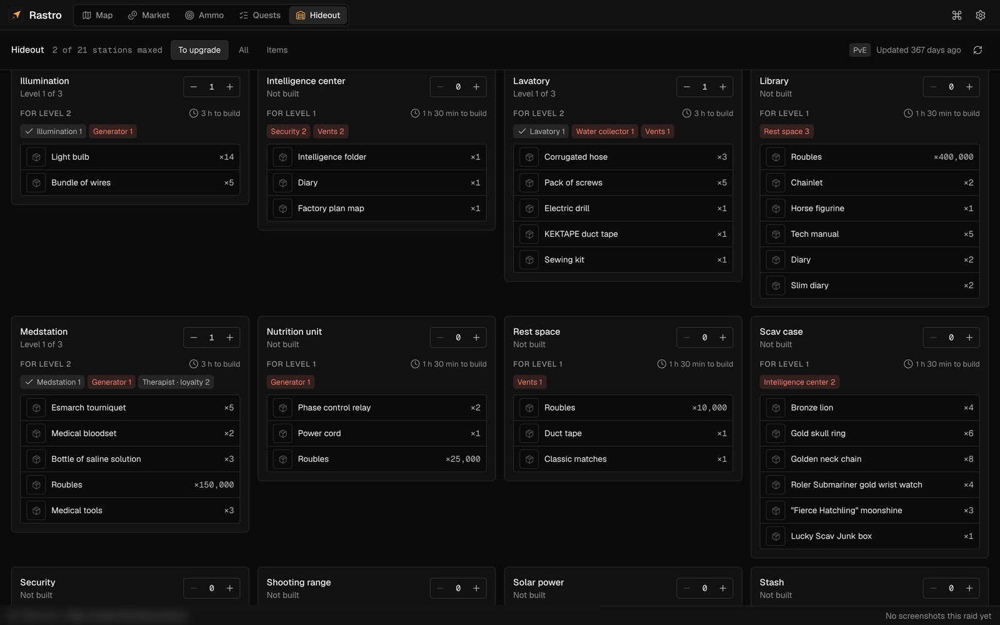

  <a href="../../README.fr.md">Retour au README</a> · <b>Fonctionnalités</b> · <a href="GUIDE.md">Guide</a> · <a href="FAQ.md">Questions et sécurité</a>

# Fonctionnalités

<table>
  <tr><td width="50%"> Customs en raid</td><td width="50%"> Votre escouade sur une carte</td></tr>
  <tr><td width="50%"> Quêtes par marchand</td><td width="50%"> Planque</td></tr>
  <tr><td width="50%"> Les boss et leurs points d'apparition</td><td width="50%"> Horloge de raid et train</td></tr>
  <tr><td width="50%"> Serrures et prix des clés</td><td width="50%"> Étages, automatiquement</td></tr>
  <tr><td width="50%"> Marché</td><td width="50%"> Tableau des munitions</td></tr>
</table>

Cartes des <a href="https://github.com/the-hideout/tarkov-dev-svg-maps">contributeurs de tarkov.dev</a>, CC BY-NC-SA 4.0. Prix et données des objets de <a href="https://tarkov.dev">tarkov.dev</a>. Les captures de la squad utilisent des positions d'exemple. Les captures montrent l'application en anglais.

## Fonctionnalités

**Carte**
- Votre position et votre orientation, mises à jour à chaque capture, avec une trace qui s'efface progressivement là où vous êtes passé.
- Cliquez sur une extraction ou n'importe quel point pour voir la distance, de quel côté tourner et la différence de hauteur.
- Extractions filtrées par PMC, Scav ou partagées. Cochez celles que le jeu annonce ouvertes pour ce raid et les autres s'atténuent.
- Calques de tarkov.dev : transits, interrupteurs, conteneurs de loot (filtrables par type) et serrures.
- Les cartes à plusieurs étages vous suivent automatiquement, ou vous en choisissez un dans le panneau des étages. Le reste de la carte et tout ce qui est sur d'autres étages est atténué.
- Survolez n'importe quoi pour une fiche indiquant ce que c'est, à quelle distance, à quel étage et ce que fait un clic.
- Vos propres points : clic droit sur la carte pour enregistrer des spots de loot, des zones dangereuses, des caches ou des lieux de quête. Ils sont stockés en coordonnées du jeu et survivent donc à la réinstallation d'une carte.

**Quêtes**
- Toutes les quêtes dans votre langue : celles en cours, celles que vous pouvez commencer et, pour les autres, exactement ce qui manque (votre niveau ou les quêtes précédentes). Filtrez par marchand, carte ou Kappa, ou cherchez des quêtes, des objectifs et des objets.
- **Les quêtes suivent le jeu.** Avec la détection des raids activée, les quêtes que vous acceptez, rendez ou ratez se cochent toutes seules depuis les journaux du jeu, PvP et PvE séparés. La première fois, Rastro lit tous les lancements gardés par le jeu : en milieu de wipe, vous êtes à jour d’un coup. Pas de journaux ? *Se mettre à jour* en choisissant la dernière quête faite chez chaque marchand.
- Chaque quête affiche son marchand, son image et ses récompenses : expérience, réputation, objets, ainsi que les offres et fabrications qu’elle débloque.
- Vos objectifs restants sur la carte, honnêtes sur les données : un badge pour un endroit précis, le vrai contour pour une zone, et de petits points pour les endroits où un objet *peut* apparaître. Cliquez dessus et Rastro vous y guide, comme vers une extraction. Un endroit faux ? *Mal placé ?* le signale en un clic.
- **Plan de raid** dans le panneau *Quêtes* : cochez ce que vous ferez dans ce raid et la carte n’affiche que ça, numéroté selon le chemin le plus court, avec ce qu’il faut emporter. *Ensuite* affiche le prochain objectif en grand ; *À rendre* liste ce qui est prêt.
- Les quêtes par marchand, comme dans le jeu, avec votre progression Kappa et Lightkeeper, la carte où vous avancerez le plus, et *Objets* : ce que vos quêtes demandent encore, pour ne pas le vendre.

**Planque**
- Indiquez le niveau de chaque module et voyez ce que demande le suivant : objets, autres modules, loyauté des marchands, compétences et durée de construction. Les conditions remplies passent au vert.
- *Objets* additionne quêtes et planque : ce que les deux demandent encore, pour le niveau suivant ou pour tous ceux qui restent. La fiche de l'objet dans le Marché indique quels modules en ont besoin.

**Boss et horloge de raid**
- Le calque *Boss* montre où chaque boss peut apparaître et la probabilité de le croiser là. Survolez pour la zone, l'escorte et l'heure d'arrivée ; cliquez pour voir tous les points d'apparition. Les probabilités suivent votre mode de jeu.
- Dans le menu, la barre du haut affiche l'heure de Tarkov des deux côtés, pour choisir jour ou nuit. En raid : le temps restant et, d'après votre dernière capture, l'heure dans votre raid.
- Cliquez pour voir quand le raid se termine, la fenêtre du train blindé sur Reserve et Lighthouse, et les boss de la carte.

**Clés**
- Le calque *Serrures* montre chaque porte, conteneur et coffre de voiture qui demande une clé. Les serrures qui ont besoin de courant ont un contour jaune.
- Cliquez sur une serrure pour voir quelle clé l'ouvre, où l'acheter le moins cher et son meilleur prix de revente.
- *Mettre cette clé en évidence* atténue toutes les autres serrures, pour voir tout ce qu'une seule clé ouvre.
- Chaque clé du Marché indique les cartes installées où elle sert, avec un lien qui y mène directement.

**Marché**
- Cherchez dans tout le catalogue par nom ou nom court. Les accents et l'ordre des mots n'ont pas d'importance. Appuyez sur `/` pour chercher et sur les flèches pour parcourir les résultats.
- Triez par meilleure vente, prix au marché aux puces, moyenne sur 24 heures, variation sur 48 heures ou prix par case d'inventaire.
- Chaque objet liste toutes les offres des marchands et du marché aux puces, avec le niveau de marchand requis et le prix d'origine en dollars ou en euros.
- Le catalogue est téléchargé une fois puis consulté sur votre PC : les recherches sont instantanées et fonctionnent hors ligne.

**Munitions**
- Toutes les cartouches regroupées par calibre et triées par pénétration.
- Dégâts (par plomb × nombre de plombs pour la chevrotine), pénétration, dégâts à l'armure, chance de fragmentation, vitesse initiale et l'endroit le moins cher pour l'acheter. Les traçantes sont signalées.

**Détection des raids** (facultatif)
- Passe à la bonne carte quand un raid se charge, efface votre trace et vos marques au début de chaque raid et affiche le temps restant. Lit les journaux du jeu, comme expliqué dans [Comment ça marche](GUIDE.md#comment-ça-marche).

**Tout le reste**
- 16 langues, les mêmes que tarkov.dev : Čeština, Deutsch, English, Español, Français, Magyar, Italiano, 日本語, 한국어, Polski, Português, Română, Русский, Slovenčina, Türkçe et 中文. Les noms des objets, des cartes et des extractions suivent aussi votre langue. Si vous la changez, Rastro propose de passer vos cartes, prix et quêtes dans la nouvelle langue.
- Données PvP et PvE, choisies automatiquement d'après les journaux du jeu ou à la main.
- Notifications de mise à jour facultatives et une page *Nouveautés* après chaque mise à jour.
- Des raccourcis clavier pour tout et une palette de commandes (`Ctrl+K`).

## Jouez avec votre squad

Le mode groupe de Rastro met toute votre squad sur la même carte, chacun avec son nom et sa couleur.

- **Voyez où est chacun.** La flèche de chaque coéquipier montre où il était et dans quelle direction il regardait lors de sa dernière capture. Si quelqu'un est à un autre étage, sa flèche s'atténue et la survoler indique à quel étage il se trouve.
- **Pinguez un endroit.** `Maj` + clic n'importe où sur la carte et l'endroit clignote sur l'écran de tout le monde.
- **Facile à mettre en place.** Un joueur ouvre un salon et copie un code d'invitation. Les autres le collent dans *Rejoindre*. C'est tout. Jusqu'à 8 joueurs.
- **Sans serveur ni compte.** Les positions vont directement de PC à PC. Personne d'autre ne les voit, pas même nous.
- **Chiffré.** Tout le trafic est chiffré de bout en bout avec le [protocole Noise](https://noiseprotocol.org/). Le code d'invitation est la clé : ne le partagez qu'avec votre squad.

Les autres doivent pouvoir joindre le PC de l'hôte. Le plus simple est un VPN mesh gratuit comme [Tailscale](https://tailscale.com/) ou [ZeroTier](https://www.zerotier.com/) : chacun l'installe une fois et Rastro fonctionne comme si vous étiez sur le même réseau, sans ouvrir de port sur la box. Ouvrir un port sur la box de l'hôte fonctionne aussi.

Chaque joueur utilise quand même Rastro sur son propre PC et fait ses propres captures : c'est ce qui garde la position de tout le monde à jour.
