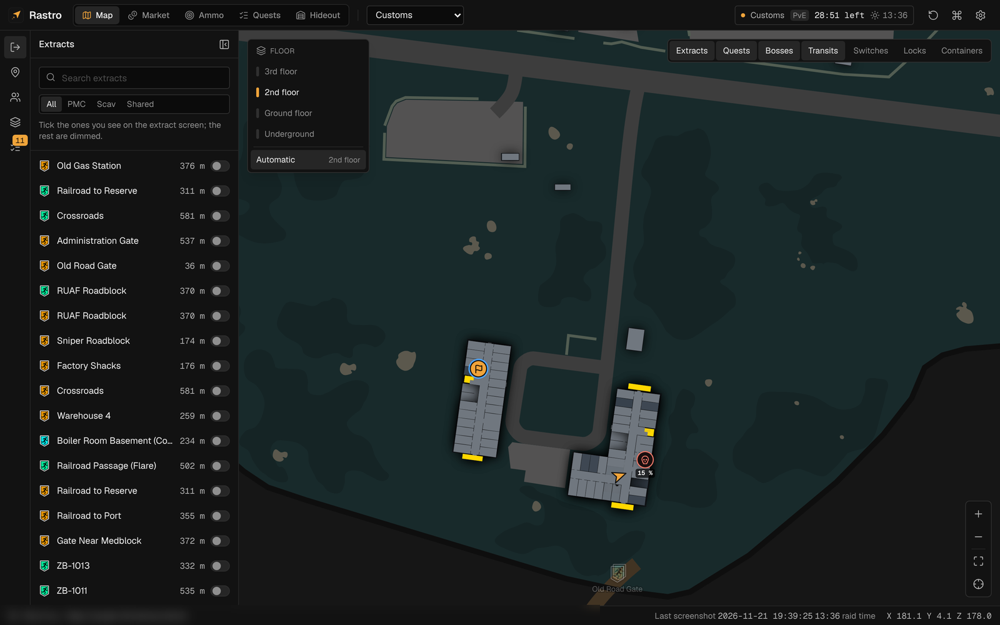

  <a href="../../README.pl.md">Powrót do README</a> · <b>Funkcje</b> · <a href="GUIDE.md">Przewodnik</a> · <a href="FAQ.md">Pytania i bezpieczeństwo</a>

# Funkcje

<table>
  <tr><td width="50%"> Customs w rajdzie</td><td width="50%"> Twoja drużyna na jednej mapie</td></tr>
  <tr><td width="50%"> Zadania według handlarzy</td><td width="50%"> Kryjówka</td></tr>
  <tr><td width="50%"> Bossowie i ich punkty pojawiania się</td><td width="50%"> Zegar rajdu i pociąg</td></tr>
  <tr><td width="50%"> Zamki i ceny kluczy</td><td width="50%"> Piętra, automatycznie</td></tr>
  <tr><td width="50%"> Rynek</td><td width="50%"> Tabela amunicji</td></tr>
</table>

Mapy autorstwa <a href="https://github.com/the-hideout/tarkov-dev-svg-maps">współtwórców tarkov.dev</a>, CC BY-NC-SA 4.0. Ceny i dane przedmiotów z <a href="https://tarkov.dev">tarkov.dev</a>. Zrzuty drużyny używają przykładowych pozycji. Zrzuty pokazują aplikację po angielsku.

## Funkcje

**Mapa**
- Twoja pozycja i kierunek, aktualizowane przy każdym zrzucie ekranu, z zanikającym śladem przebytej drogi.
- Kliknij ewakuację lub dowolny punkt, żeby zobaczyć odległość, w którą stronę skręcić i różnicę wysokości.
- Ewakuacje filtrowane na PMC, Scav i wspólne. Zaznacz te, które gra pokazuje jako otwarte w tym rajdzie, a reszta zostanie przyciemniona.
- Warstwy z tarkov.dev: przejścia, przełączniki, pojemniki z lootem (z filtrem typu) i zamki.
- Mapy z kilkoma piętrami same za tobą podążają albo wybierasz piętro w panelu pięter. Reszta mapy i wszystko na innych piętrach jest przyciemnione.
- Najedź na cokolwiek, żeby zobaczyć kartę z nazwą, odległością, piętrem i tym, co robi kliknięcie.
- Własne punkty: prawy klik na mapie, żeby zapisać miejsca z lootem, niebezpieczne strefy, skrytki albo miejsca zadań. Zapisują się we współrzędnych gry, więc przetrwają ponowną instalację mapy.

**Zadania**
- Wszystkie zadania w twoim języku: te w toku, te, które możesz już zacząć, a przy reszcie dokładnie to, czego brakuje (twój poziom albo wcześniejsze zadania). Filtruj według handlarza, mapy lub Kappy albo szukaj zadań, celów i przedmiotów.
- **Zadania podążają za grą.** Przy włączonym wykrywaniu rajdu zadania, które przyjmiesz, oddasz lub oblejesz, odhaczają się same z logów gry, osobno dla PvP i PvE. Za pierwszym razem Rastro czyta wszystkie uruchomienia zachowane przez grę, więc w połowie wipe'a od razu nadrabiasz postęp. Brak logów? *Nadrób postęp*, wybierając ostatnie zadanie u każdego handlarza.
- Każde zadanie pokazuje handlarza, swój obrazek i nagrody: doświadczenie, reputację, przedmioty oraz oferty i receptury, które odblokowuje.
- Twoje otwarte cele na mapie, uczciwie wobec danych: znaczek dla dokładnego miejsca, prawdziwy obrys dla obszaru i małe kropki dla miejsc, gdzie przedmiot *może* się pojawić. Kliknij, a Rastro cię poprowadzi jak do ewakuacji. Złe miejsce? *Złe miejsce?* zgłasza je jednym kliknięciem.
- **Plan rajdu** w panelu *Zadania*: zaznacz, co zrobisz w tym rajdzie, a mapa pokaże tylko to, ponumerowane wzdłuż najkrótszej trasy, razem z tym, co zabrać. *Następne* pokazuje duży kolejny cel; *Do oddania* — to, co gotowe.
- Zadania według handlarzy, jak w grze, z postępem Kappy i Lightkeepera, mapą, na której zrobisz najwięcej, oraz *Przedmiotami*: tym, czego twoje zadania jeszcze wymagają, żebyś tego nie sprzedał.

**Kryjówka**
- Ustaw poziom każdego modułu i zobacz, czego wymaga następny: przedmiotów, innych modułów, lojalności handlarzy, umiejętności i czasu budowy. Spełnione wymagania robią się zielone.
- *Przedmioty* sumują zadania i kryjówkę: czego jeszcze wymagają, na następny poziom albo na wszystkie pozostałe. Karta przedmiotu w Rynku mówi, które moduły go potrzebują.

**Bossowie i zegar rajdu**
- Warstwa *Bossowie* pokazuje, gdzie może pojawić się każdy boss i jaka jest szansa, że tam będzie. Najedź, by zobaczyć strefę, eskortę i czas przybycia; kliknij, by zobaczyć wszystkie punkty pojawiania się. Szanse zależą od trybu gry.
- W menu górny pasek pokazuje czas w Tarkowie po obu stronach, żeby wybrać dzień lub noc. W rajdzie: pozostały czas i, według ostatniego zrzutu, godzinę w twoim rajdzie.
- Kliknij, by zobaczyć, kiedy kończy się rajd, okno pociągu pancernego na Reserve i Lighthouse oraz bossów mapy.

**Klucze**
- Warstwa *Zamki* pokazuje wszystkie drzwi, pojemniki i bagażniki, które wymagają klucza. Zamki wymagające prądu mają żółtą obwódkę.
- Kliknij zamek, żeby zobaczyć, jaki klucz go otwiera, gdzie kupić go najtaniej i za ile najlepiej sprzedać.
- *Wyróżnij ten klucz* przyciemnia wszystkie inne zamki, żeby było widać wszystko, co otwiera jeden klucz.
- Każdy klucz na Rynku pokazuje zainstalowane mapy, na których się przydaje, z linkiem prosto do nich.

**Rynek**
- Przeszukuj cały katalog przedmiotów po nazwie albo nazwie skróconej. Polskie znaki i kolejność słów nie mają znaczenia. Wciśnij `/`, żeby szukać, i strzałki, żeby poruszać się po wynikach.
- Sortuj po najlepszej cenie sprzedaży, cenie na pchlim targu, średniej z 24 godzin, zmianie z 48 godzin albo cenie za slot ekwipunku.
- Każdy przedmiot pokazuje wszystkie oferty handlarzy i pchlego targu, z wymaganym poziomem handlarza i ceną oryginalną w dolarach albo euro.
- Katalog pobiera się raz i przeszukuje na twoim PC, więc wyszukiwanie jest natychmiastowe i działa offline.

**Amunicja**
- Wszystkie naboje pogrupowane według kalibru i posortowane według penetracji.
- Obrażenia (na śrucinę × liczba śrucin dla śrutu), penetracja, obrażenia pancerza, szansa fragmentacji, prędkość wylotowa i najtańsze miejsce zakupu. Smugacze są oznaczone.

**Wykrywanie rajdu** (opcjonalne)
- Przełącza na właściwą mapę, gdy rajd się wczytuje, czyści ślad i znaczniki na początku każdego rajdu i pokazuje pozostały czas. Czyta logi gry, jak opisano w [Jak to działa](GUIDE.md#jak-to-działa).

**Cała reszta**
- 16 języków, tych samych co w tarkov.dev: Čeština, Deutsch, English, Español, Français, Magyar, Italiano, 日本語, 한국어, Polski, Português, Română, Русский, Slovenčina, Türkçe i 中文. Nazwy przedmiotów, map i ewakuacji też są w twoim języku. Po zmianie języka Rastro zaproponuje przełączenie map, cen i zadań.
- Dane PvP i PvE, wybierane automatycznie na podstawie logów gry albo ręcznie.
- Opcjonalne powiadomienia o aktualizacjach i strona *Co nowego* po każdej aktualizacji.
- Skróty klawiszowe do wszystkiego i paleta poleceń (`Ctrl+K`).

## Graj z drużyną

Tryb drużyny w Rastro umieszcza całą twoją drużynę na tej samej mapie, każdego z własną nazwą i kolorem.

- **Widzisz, gdzie jest każdy.** Strzałka każdego kolegi pokazuje, gdzie był i w którą stronę patrzył przy ostatnim zrzucie. Jeśli ktoś jest na innym piętrze, jego strzałka jest przyciemniona, a po najechaniu widać, na którym.
- **Pinguj miejsce.** `Shift` + klik w dowolne miejsce mapy, a to miejsce zamiga na ekranie każdego.
- **Łatwa konfiguracja.** Jeden gracz otwiera pokój i kopiuje kod zaproszenia. Reszta wkleja go w *Dołącz*. I tyle. Do 8 graczy.
- **Bez serwera i konta.** Pozycje idą prosto z PC do PC. Nikt inny ich nie widzi, nawet my.
- **Szyfrowanie.** Cały ruch jest szyfrowany end-to-end [protokołem Noise](https://noiseprotocol.org/). Kod zaproszenia jest kluczem, więc udostępniaj go tylko swojej drużynie.

Pozostali muszą mieć dostęp do PC hosta. Najprościej użyć darmowego VPN typu mesh, jak [Tailscale](https://tailscale.com/) albo [ZeroTier](https://www.zerotier.com/): każdy instaluje go raz, a Rastro działa tak, jakbyście byli w jednej sieci, bez otwierania portów na routerze. Otwarcie portu na routerze hosta też zadziała.

Każdy gracz i tak uruchamia Rastro na swoim PC i robi własne zrzuty: dzięki temu pozycje wszystkich są aktualne.
