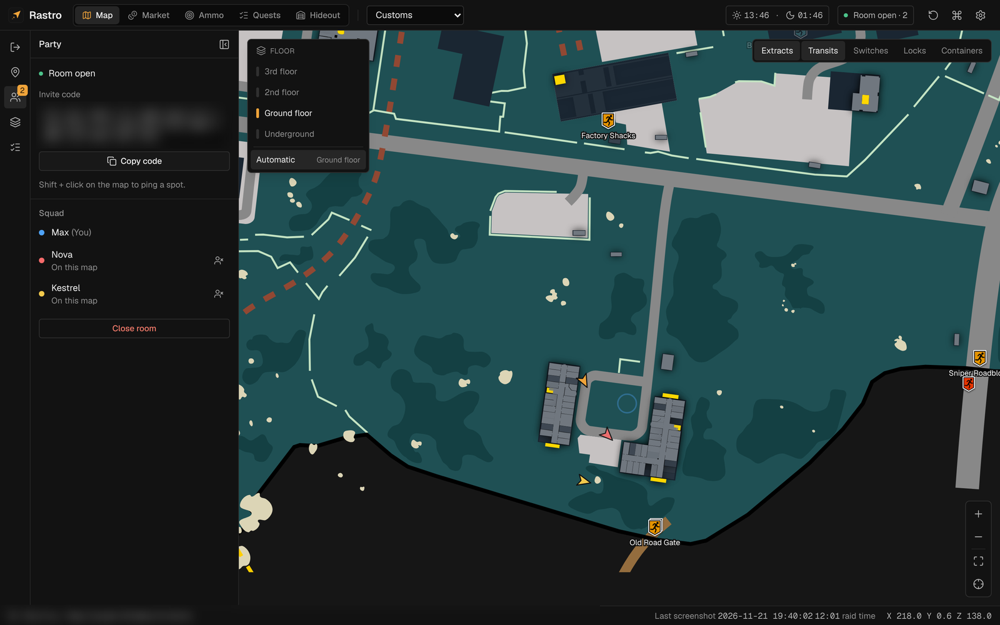

  <a href="https://maxsala.github.io/rastro-tarkov/ru/docs/features/">Сайт</a> · <a href="../../README.ru.md">Назад к README</a> · <b>Возможности</b> · <a href="GUIDE.md">Руководство</a> · <a href="FAQ.md">Вопросы и безопасность</a>

# Возможности

<table>
  <tr><td width="50%"> Таможня в рейде</td><td width="50%"> Ваш отряд на одной карте</td></tr>
  <tr><td width="50%"> Задания по торговцам</td><td width="50%"> Убежище</td></tr>
  <tr><td width="50%"> Боссы и их точки появления</td><td width="50%"> Часы рейда и поезд</td></tr>
  <tr><td width="50%"> Замки и цены ключей</td><td width="50%"> Этажи, автоматически</td></tr>
  <tr><td width="50%"> Рынок</td><td width="50%"> Таблица патронов</td></tr>
</table>

Карты от <a href="https://github.com/the-hideout/tarkov-dev-svg-maps">участников tarkov.dev</a>, CC BY-NC-SA 4.0. Цены и данные о предметах с <a href="https://tarkov.dev">tarkov.dev</a>. На скриншотах отряда позиции примерные. На скриншотах интерфейс на английском.

## Возможности

**Карта**
- Ваша позиция и направление обновляются при каждом скриншоте, а пройденный путь остаётся постепенно исчезающим следом.
- Кликните по выходу или любой точке, чтобы увидеть расстояние, куда повернуть и разницу по высоте.
- Фильтр выходов: ЧВК, Дикий или общие. Отметьте те, что игра показала открытыми в этом рейде, и остальные затемнятся.
- Слои с tarkov.dev: переходы, рубильники, контейнеры с лутом (с фильтром по типу) и замки.
- Многоэтажные карты автоматически следуют за вами, или вы выбираете этаж на панели этажей. Остальная карта и всё, что на других этажах, затемняется.
- Наведите курсор на что угодно, и появится карточка: что это, как далеко, на каком этаже и что произойдёт по клику.
- Свои точки: правый клик по карте, чтобы сохранить места лута, опасные зоны, тайники или места квестов. Они хранятся в игровых координатах, поэтому переживают переустановку карты.

**Задания**
- Все задания на вашем языке: какие вы выполняете, какие можно взять прямо сейчас, а для остальных — чего именно не хватает (уровня или предыдущих заданий). Фильтры по торговцу, карте и Kappa, поиск по заданиям, целям и предметам.
- **Задания следуют за игрой.** Если включено определение рейда, задания, которые вы берёте, сдаёте или проваливаете, отмечаются сами по логам игры, отдельно для PvP и PvE. В первый раз Rastro читает все запуски, сохранённые игрой, так что в середине вайпа прогресс сразу актуален. Логов нет? *Наверстать*: выберите последнее задание у каждого торговца.
- У каждого задания видны торговец, картинка и награды: опыт, репутация, предметы, а также открываемые предложения и крафты.
- Ваши невыполненные цели на карте, честно по данным: значок для точного места, настоящий контур для зоны и маленькие точки для мест, где предмет *может* появиться. Нажмите — и Rastro поведёт вас, как к выходу. Видите ошибку? *Не то место?* сообщит о ней в один клик.
- **План рейда** в панели *Задания*: отметьте, что сделаете в этом рейде, и на карте останется только это, пронумерованное по кратчайшему маршруту, вместе со списком того, что взять. *Дальше* крупно показывает следующую цель; *Сдать* — то, что уже готово.
- Задания по торговцам, как в игре, с прогрессом Kappa и Смотрителя, картой, где больше всего дел, и *Предметами*: тем, что ещё нужно заданиям, чтобы вы это не продали.

**Убежище**
- Укажите уровень каждого модуля и посмотрите, что нужно для следующего: предметы, другие модули, лояльность торговцев, навыки и время постройки. Выполненные требования становятся зелёными.
- *Предметы* складывают задания и убежище: что ещё нужно, для следующего уровня или для всех оставшихся. Карточка предмета на Рынке показывает, каким модулям он нужен.

**Боссы и часы рейда**
- Слой *Боссы* показывает, где может появиться каждый босс и вероятность встретить его там. Наведите, чтобы увидеть зону, свиту и время появления; щёлкните, чтобы увидеть все точки появления. Вероятности зависят от режима игры.
- В меню верхняя панель показывает время в Таркове с обеих сторон, чтобы выбрать день или ночь. В рейде — оставшееся время и, по последнему скриншоту, время в вашем рейде.
- Щёлкните, чтобы узнать, когда закончится рейд, окно бронепоезда на Резерве и Маяке и боссов карты.

**Ключи**
- Слой *Замки* показывает каждую дверь, контейнер и багажник, которым нужен ключ. Замки, которым нужно электричество, обведены жёлтым.
- Кликните по замку, чтобы узнать, какой ключ его открывает, где его купить дешевле всего и за сколько лучше продать.
- *Выделить этот ключ* затемняет все остальные замки, чтобы было видно всё, что открывает один ключ.
- Для каждого ключа на Рынке указаны установленные карты, где он используется, со ссылкой прямо туда.

**Рынок**
- Поиск по всему каталогу предметов по названию или короткому названию. Порядок слов и диакритика не важны. Нажмите `/` для поиска и стрелки для перемещения по результатам.
- Сортировка по лучшей цене продажи, цене на барахолке, средней цене за 24 часа, изменению за 48 часов или цене за клетку инвентаря.
- У каждого предмета перечислены все предложения торговцев и барахолки, с нужным уровнем торговца и исходной ценой в долларах или евро.
- Каталог скачивается один раз, а поиск идёт на вашем ПК, поэтому он мгновенный и работает офлайн.

**Патроны**
- Все патроны сгруппированы по калибрам и отсортированы по пробитию.
- Урон (за дробину × количество дробин для картечи), пробитие, урон броне, шанс фрагментации, начальная скорость и где купить дешевле всего. Трассеры отмечены.

**Определение рейда** (по желанию)
- Переключается на нужную карту при загрузке рейда, сбрасывает след и метки в начале каждого рейда и показывает оставшееся время. Читает логи игры, как описано в разделе [Как это работает](GUIDE.md#как-это-работает).

**Всё остальное**
- 16 языков, те же, что поддерживает tarkov.dev: Čeština, Deutsch, English, Español, Français, Magyar, Italiano, 日本語, 한국어, Polski, Português, Română, Русский, Slovenčina, Türkçe и 中文. Названия предметов, карт и выходов тоже на вашем языке. При смене языка Rastro предложит перевести карты, цены и задания.
- Данные для PvP и PvE, выбираются автоматически по логам игры или вручную.
- Уведомления об обновлениях по желанию и страница *Что нового* после каждого обновления.
- Горячие клавиши для всего и палитра команд (`Ctrl+K`).

## Играйте с отрядом

Режим группы в Rastro выводит весь отряд на одну карту, у каждого своё имя и цвет.

- **Видно, где каждый.** Стрелка каждого товарища показывает, где он был и куда смотрел на момент последнего скриншота. Если кто-то на другом этаже, его стрелка затемняется, а при наведении видно, на каком он этаже.
- **Метка на карте.** `Shift` + клик в любом месте карты, и это место вспыхнет на экране у всех.
- **Легко настроить.** Один игрок создаёт комнату и копирует код приглашения. Остальные вставляют его в поле *Войти*. Всё. До 8 игроков.
- **Без сервера и аккаунта.** Позиции идут напрямую с ПК на ПК. Никто посторонний их не видит, включая нас.
- **Шифрование.** Весь трафик зашифрован сквозным шифрованием по [протоколу Noise](https://noiseprotocol.org/). Код приглашения — это ключ, поэтому делитесь им только со своим отрядом.

Остальные должны иметь доступ к ПК хоста. Проще всего использовать бесплатную mesh-VPN, например [Tailscale](https://tailscale.com/) или [ZeroTier](https://www.zerotier.com/): каждый устанавливает её один раз, и Rastro работает так, будто вы в одной сети, без открытия портов на роутере. Открыть порт на роутере хоста тоже подойдёт.

Каждый игрок всё равно запускает Rastro на своём ПК и делает свои скриншоты: именно так позиции всех остаются актуальными.
