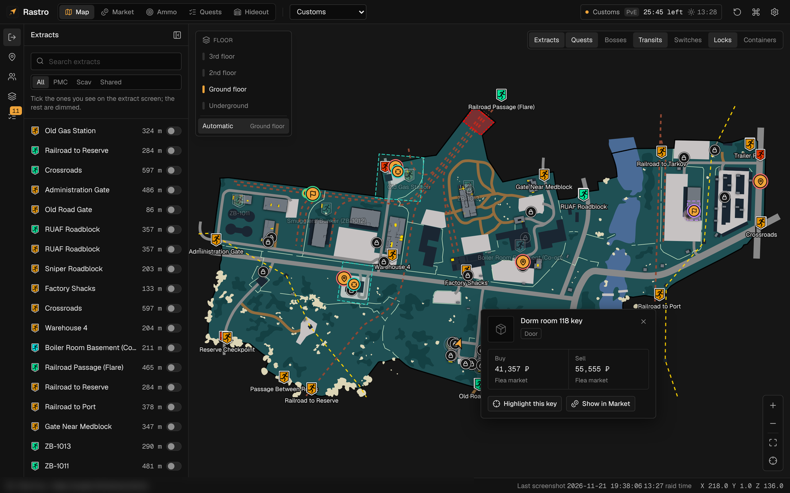
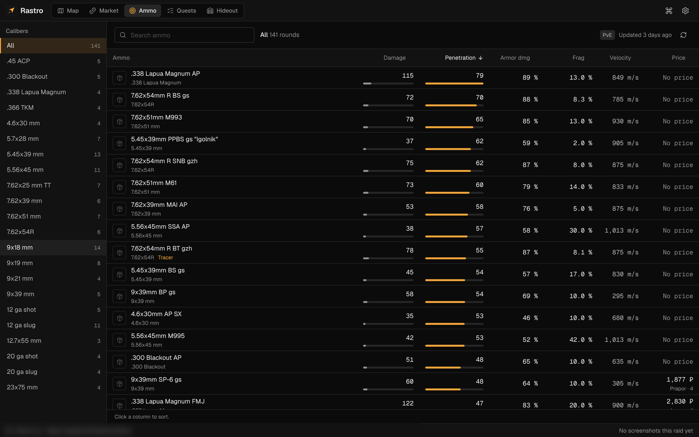

  <a href="../../README.zh-CN.md">返回 README</a> · <b>功能</b> · <a href="GUIDE.md">指南</a> · <a href="FAQ.md">常见问题与安全</a>

# 功能

<table>
  <tr><td width="50%"> 海关战局中</td><td width="50%"> 小队同在一张地图</td></tr>
  <tr><td width="50%"> 按商人分类的任务</td><td width="50%"> 藏身处</td></tr>
  <tr><td width="50%"> 首领及其刷新点</td><td width="50%"> 战局时钟与列车</td></tr>
  <tr><td width="50%"> 门锁与钥匙价格</td><td width="50%"> 自动切换楼层</td></tr>
  <tr><td width="50%"> 市场</td><td width="50%"> 弹药表</td></tr>
</table>

地图来自 <a href="https://github.com/the-hideout/tarkov-dev-svg-maps">tarkov.dev 贡献者</a>，CC BY-NC-SA 4.0。价格和物品数据来自 <a href="https://tarkov.dev">tarkov.dev</a>。小队截图使用的是示例位置。截图中的应用界面为英文。

## 功能

**地图**
- 每次截图都会更新你的位置和朝向，并留下一条逐渐淡出的轨迹。
- 点击撤离点或任意位置，查看距离、该往哪边转以及高度差。
- 撤离点可按 PMC、Scav 或共用筛选。勾选游戏提示本局开放的撤离点，其余的会被调暗。
- 来自 tarkov.dev 的图层：转移点、开关、物资容器（可按类型筛选）和门锁。
- 多层地图会自动跟随你切换楼层，也可以在楼层面板中手动选择。地图的其余部分以及其他楼层上的内容都会被调暗。
- 鼠标移到任何东西上都会显示信息卡：是什么、有多远、在哪一层以及点击后会发生什么。
- 自定义标点：在地图上右键保存物资点、危险区域、藏匿点或任务地点。标点以游戏坐标保存，重新安装地图也不会丢失。

**任务**
- 所有任务都用你的语言显示：正在做的、现在就能接的，以及其余任务到底还差什么（你的等级或前置任务）。可按商人、地图或 Kappa 筛选，也能搜索任务、目标和物品。
- **任务跟随游戏。** 开启战局检测后，你接受、提交或失败的任务会根据游戏日志自动标记，PvP 和 PvE 分开记录。第一次运行时，Rastro 会读取游戏保留的所有启动记录，赛季中途也能立刻补齐进度。没有日志？用 *补齐进度* 为每个商人选择最后完成的任务。
- 每个任务都会显示商人、任务图片和奖励：经验、声望、物品，以及它解锁的商人商品和制作配方。
- 地图上的未完成目标如实反映数据：精确地点显示徽标，区域显示真实轮廓，物品*可能*刷新的地点显示小圆点。点一下，Rastro 就像导航到撤离点一样带你过去。发现位置不对？点 *位置不对？* 一键报告。
- *任务*面板里的**战局计划**：勾选这局要做的事，地图只显示这些，并按最短路线编号，还会列出要带的东西。*下一步* 用大字显示下一个目标；*待提交* 列出已经可以交的任务。
- 像游戏里一样按商人浏览任务，显示 Kappa 和 Lightkeeper 进度、最值得去的地图，以及*物品*：任务还需要的东西，免得你卖掉。

**藏身处**
- 设置每个设施的等级，查看下一级需要什么：物品、其他设施、商人信任、技能和建造时间。满足的条件会变成绿色。
- *物品* 会把任务和藏身处的需求加在一起：下一级或剩余所有等级还需要什么。市场中的物品卡片会显示哪些设施需要它。

**首领与战局时钟**
- *首领* 图层显示每个首领可能出现的位置，以及在那里遇到它的概率。悬停查看区域、随从和出现时间；点击查看所有刷新点。概率会跟随你的游戏模式。
- 在菜单中，顶部栏会显示两侧的塔科夫时间，方便选择白天或夜晚。战局中：剩余时间，以及根据最近截图得出的战局内时间。
- 点击查看战局何时结束、储备站和灯塔的装甲列车时间窗口，以及本地图的首领。

**钥匙**
- *门锁* 图层显示每一扇需要钥匙的门、每一个容器和汽车后备箱。需要通电的锁带有黄色边框。
- 点击一把锁，查看能打开它的钥匙、在哪里买最便宜以及最高卖价。
- *高亮这把钥匙* 会调暗其他所有锁，让你看到一把钥匙能打开的全部地方。
- 市场里的每把钥匙都会列出它在哪些已安装的地图上使用，并附带直接跳转的链接。

**市场**
- 按名称或简称搜索完整的物品目录，不区分重音和词序。按 `/` 开始搜索，用方向键浏览结果。
- 可按最高卖价、跳蚤市场价格、24 小时均价、48 小时涨跌或每格价格排序。
- 每个物品都列出所有商人和跳蚤市场的报价，包括所需的商人等级以及原始的美元或欧元价格。
- 目录只需下载一次，在你的电脑上搜索，所以搜索是即时的，离线也能用。

**弹药**
- 所有子弹按口径分组，并按穿透排序。
- 伤害（霰弹为单颗弹丸伤害 × 弹丸数）、穿透、护甲伤害、碎裂概率、初速以及最便宜的购买途径。曳光弹有标记。

**战局检测**（可选）
- 战局加载时切换到正确的地图，每场战局开始时清除轨迹和标记，并显示剩余时间。它读取游戏日志，详见[工作原理](GUIDE.md#工作原理)。

**其他**
- 16 种语言，与 tarkov.dev 支持的相同：Čeština、Deutsch、English、Español、Français、Magyar、Italiano、日本語、한국어、Polski、Português、Română、Русский、Slovenčina、Türkçe 和中文。物品、地图和撤离点名称也会跟随你的语言。切换语言后，Rastro 会提议把你的地图、价格和任务一起切换过去。
- PvP 和 PvE 数据，可根据游戏日志自动选择，也可手动选择。
- 可选的更新提醒，每次更新后显示 *新功能* 页面。
- 所有功能都有快捷键，还有命令面板（`Ctrl+K`）。

## 和小队一起玩

Rastro 的小队模式让整个小队出现在同一张地图上，每个人都有自己的名字和颜色。

- **看到每个人的位置。** 每位队友的箭头显示他最后一次截图时所在的位置和朝向。如果有人在别的楼层，他的箭头会变暗，鼠标移上去就能看到他在几楼。
- **标点。** `Shift` + 点击地图上任意位置，这个地方就会在所有人的屏幕上闪烁。
- **设置简单。** 一名玩家创建房间并复制邀请码，其他人把它粘贴到 *加入* 里，就这么简单。最多 8 名玩家。
- **无服务器，无账号。** 位置数据直接在电脑之间传输。除了你们，没人能看到，包括我们。
- **加密。** 所有流量都使用 [Noise 协议](https://noiseprotocol.org/)端到端加密。邀请码就是密钥，所以只分享给你的小队。

其他人需要能连接到房主的电脑。最简单的办法是使用免费的组网 VPN，比如 [Tailscale](https://tailscale.com/) 或 [ZeroTier](https://www.zerotier.com/)：每个人安装一次，Rastro 就能像在同一个局域网里一样工作，不用在路由器上开端口。在房主的路由器上开放端口也可以。

每位玩家仍然在自己的电脑上运行 Rastro 并自己截图：正是这样才能让每个人的位置保持最新。
